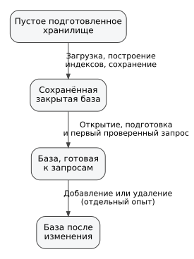
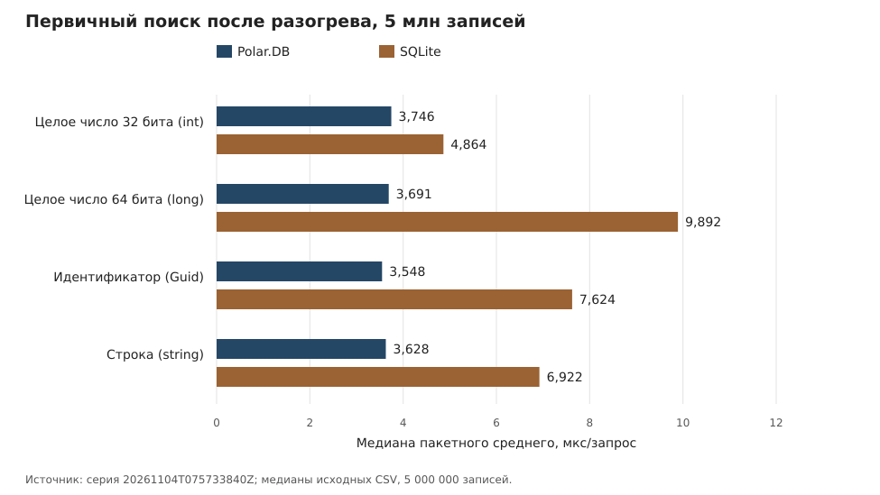
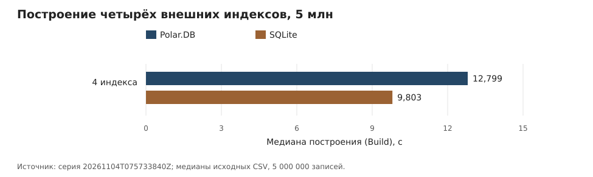
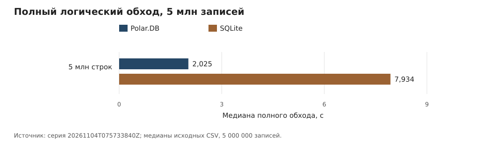

# Экспериментальное исследование характеристик последовательностей и индексных построений библиотеки Polar.DB

УДК 004.65

## Аннотация

В работе исследуются характеристики последовательностей и индексных построений библиотеки Polar.DB при сопоставлении со SQLite. Вместо единого показателя производительности раздельно измерены поиск по первичному и внешним индексам, их построение, полный логический обход, добавление и удаление, повторное открытие и расход управляемой памяти. Детерминированные массивы из 50 тыс. и 5 млн записей использовались в новой серии на Linux/WSL2/ext4. Набор охватывает 19 сценариев; 220 проверок количества строк и контрольных сумм завершились успешно. Приведены медианы внутрисерийных измерений; независимых повторов полной серии недостаточно для доверительных интервалов.

На массиве из 5 млн записей в восьми сочетаниях типа первичного ключа и режима подготовки медиана пакетного среднего времени запроса у Polar.DB ниже, чем у SQLite. Медиана полного обхода составляет 2,025 с у Polar.DB и 7,934 с у SQLite. Внутренняя стадия `Build` первичного индекса Int32 имеет медиану 165,089 мс, при этом за стадию выделяется около 60,1 МБ управляемой памяти. Отдельная стадия `Load` выполняет часть работы с ключами, поэтому `Build` не характеризует полную стоимость индексирования.

Построение четырёх внешних индексов впервые измерено для 5 млн записей: медианы стадии `Build` равны 12,799 с у Polar.DB и 9,803 с у SQLite, при этом Polar.DB выделяет около 12,64 ГБ управляемой памяти суммарно за стадию. Медианы повторного открытия Polar.DB составляют 3,674 с для конструирования и закрытия объектов и 9,551 с для готовности к запросам; две измеренные стадии строкового внешнего индекса вместе занимают медианно 88,7% времени цикла `query-ready`. Снимок управляемой памяти открытого хранилища показывает 2,222 ГБ. Эти величины не следует трактовать соответственно как время открытия только файловых дескрипторов, стоимость изолированного восстановления индексов или пик RAM.

Сопоставимость логического набора индексов при добавлении и удалении улучшена, но физическое удаление в SQLite и маркер логического удаления в Polar.DB не эквивалентны по эффектам. Для добавления при 5 млн записей Polar.DB имеет меньшие медианы в двух измеренных режимах; для удаления с фиксацией меньшая медиана наблюдается у SQLite. Исследование выявляет компромисс между подготовленным поиском и стоимостью построения/восстановления индексного состояния. При высокочастотной выборке на 50 тыс. записей после разогрева меньшие медианы наблюдаются у SQLite для всех четырёх типов ключей, тогда как на 5 млн — у Polar.DB. Исторические серии Guid сохранены в технических материалах.

**Ключевые слова:** Polar.DB, SQLite, встраиваемая база данных, индексирование, первичный ключ, внешний индекс, Guid, двоичное кодирование, повторное открытие, выделения управляемой памяти, экспериментальная производительность.

## 1. Введение

Развитие информационных систем сопровождается увеличением объёмов обрабатываемых структурированных данных и разнообразия схем их организации. Универсальные системы управления базами данных решают широкий класс задач, однако для ряда предметных областей существенное значение имеет возможность построения специализированных средств хранения, в которых представление данных и индексные построения непосредственно соответствуют структуре решаемой задачи.

Система PolarDB была предложена как средство создания специализированных баз данных и СУБД [1]. В дальнейшем была разработана библиотека PolarDB работы со структурированными данными, охватывающая типовые определения, сериализацию, отображение данных на байтовые потоки, индексные построения и другие задачи [2]. Следующим шагом стала модель базы данных, основанная на последовательности объектов, и универсальные средства индексирования последовательности [3]. В современной версии проекта используется написание **Polar.DB**; написание PolarDB в ссылках [1–3] сохранено в соответствии с опубликованными работами.

Ранее экспериментальные реализации Polar применялись, в частности, для хранения RDF и выполнения запросов SPARQL [4]. Настоящая работа продолжает это направление, но предметом эксперимента являются базовые операции универсального хранилища: построение индекса, поиск, изменение последовательности и подготовка индексного состояния после повторного открытия.

### 1.1. Актуальность исследования

Устройство индекса определяет не только время поиска, но и стоимость его построения и последующей подготовки к работе. В Polar.DB хеши первичных ключей размещаются в оперативной памяти, а смещения записей остаются в файловом представлении. Такая организация уменьшает объём постоянно размещаемых в памяти массивов, но требует обращения к файлу за смещением и подготовки индексного состояния после открытия хранилища. Поэтому исследовать один лишь поиск недостаточно.

### 1.2. Цель исследования

Цель работы — определить характеристики основных операций над последовательностью и индексами в исследуемой реализации Polar.DB: построения, поиска, обхода, изменения данных и повторного открытия. Для сопоставления используется SQLite в заранее заданной конфигурации.

### 1.3. Задачи исследования

Для этого построены два модельных массива, выделены измеряемые стадии работы с индексами, получены временные и ресурсные характеристики и выполнено сопоставление результатов операций с одинаковым логическим назначением. Отдельно рассматриваются случаи, когда совпадение назначения не означает одинакового объёма внутренней работы.

### 1.4. Исследуемые зависимости

Предполагается, что частичное размещение первичного индекса в памяти позволяет уменьшить задержку подготовленного поиска, но требует дополнительных затрат при открытии. Другой вопрос — насколько время поиска по внешнему индексу зависит от числа выдаваемых записей и как стоимость построения соотносится с расходом памяти. Наконец, для добавления и удаления необходимо различать изменение рабочего состояния и завершение операций фиксации.

В работах по экспериментальному сравнению индексных структур [5, 6] и обновляемым дисковым индексам [7] показано, что вывод может зависеть от состава нагрузки и способа учёта подготовительных операций. Поэтому измерения Polar.DB рассматриваются по отдельным стадиям, а не сводятся к единому коэффициенту ускорения.

### 1.5. Новизна и практическая значимость

Архитектурные основы PolarDB изложены ранее [1–3]. Настоящая работа дополняет их количественными характеристиками конкретной реализации. Получены данные об индексном поиске, построении индексов, повторном открытии и расходе памяти, по которым можно определить операции, требующие отдельного исследования и возможной оптимизации.

Сам способ сопоставления нагрузок не является новым: он представлен, в частности, в YCSB [8]. Компромиссы чтения, обновления и памяти исследованы в Monkey [9], а способы уменьшения затрат индекса — в ART [10] и SILT [11]. В работе Грея и Грефе [12] рассмотрена экономическая сторона размещения данных в памяти. Для Polar.DB интерес представляет конкретное сочетание этих затрат в одной реализации, а не общий вывод о превосходстве над SQLite.

### 1.6. Связь с предыдущими работами

В работах [1–3] последовательно рассмотрены средства структурного представления данных, библиотека PolarDB и последовательность объектов как основа индексных построений. В [4] показано применение специализированного хранилища к задаче RDF и SPARQL. В данной статье единицей анализа служит не прикладной запрос, а операция над индексом или последовательностью.

Классические способы индексирования описаны в обзоре B-деревьев [13] и работе об LSM-дереве [14]. Ограничения, связанные с затратами чтения, обновления и памяти, сформулированы в работе о компромиссах RUM [15]. Иные способы представления индексной функции исследованы в обучаемых индексах [16]; общие принципы организации СУБД систематизированы в [17].

Для экспериментального сопоставления индексов существенны общий набор данных и одинаковое определение измеряемой операции. На этом основаны SOSD [18] и современные сравнения индексных структур [5, 6]. Работа [19] рассматривает ошибки постановки эксперимента над СУБД; вопросы статистической повторяемости и влияния условий запуска обсуждаются в [20, 21]. Компактные структуры, сочетающие малый размер и индексный поиск, исследованы также в [22].

Перечисленные работы определяют круг сопоставимых задач и способы оценки, но не заменяют измерений конкретной реализации Polar.DB. В дальнейшем анализе отдельно учитываются различия логического назначения операций, стоимости подготовки и объёма получаемых данных.

## 2. Архитектура исследуемой реализации Polar.DB

### 2.1. Типизированная последовательность и модель изменения

Базовой физической абстракцией Polar.DB является `UniversalSequenceBase`: последовательность элементов заранее заданного структурного типа, отображаемая в байтовый поток [1–3]. Поверх неё `USequence` реализует [универсальную последовательность](POLAR_DB_ARTICLE_TECHNICAL_MATERIALS.md#term-universal-sequence) как логически редактируемое представление. Физические записи преимущественно добавляются в конец, а изменение существующей логической записи не требует обязательной перезаписи её прежнего места.

Первичный ключ задаёт логическую уникальность. Добавление нового ключа создаёт новую запись; изменение существующего значения выполняется добавлением новой версии с тем же ключом; удаление — добавлением специального пустого состояния ([маркер логического удаления (tombstone)](POLAR_DB_ARTICLE_TECHNICAL_MATERIALS.md#term-tombstone)). При чтении видимой считается последняя актуальная версия ключа ([правило последней записи (last-write-wins)](POLAR_DB_ARTICLE_TECHNICAL_MATERIALS.md#term-last-write-wins)), а прежние физические версии становятся неактуальными. Тем самым вставка, изменение и удаление сводятся к одной append-oriented операции, тогда как индексы и восстановление состояния отвечают за получение актуального логического представления.

### 2.2. Первичный индекс и смешанная резидентность

Статическая часть первичного индекса строится над последовательностью и связывает первичный ключ с физическим смещением записи. Тип пользовательского ключа (`TKey` в типизированном API) и тип внутренней индексной координаты — разные понятия: независимо от того, является ключ `int`, `long`, `Guid` или `string`, текущий первичный индекс (primary index) получает из него 32-битный `int`-хеш. Тип хеша не параметризован отдельным `THash`. Для поиска в оперативной памяти удерживается отсортированный массив этих хешей (`int[]`), тогда как статические смещения (offsets) не дублируются вторым полным массивом `long[]` и остаются в хранилище с записями фиксированной длины (fixed-size storage). После определения позиции по хешу соответствующее смещение читается по индексу из этого хранилища.

Организация доступа по первичному ключу приведена на рисунке 1.

Рисунок 1 — Доступ по первичному ключу в Polar.DB: хеши в памяти, смещения в файле

На рисунке 1 показано различие между размещаемыми в оперативной памяти хешами и файловыми смещениями. При совпадении хешей необходимо проверить полные ключи; затраты этой проверки не сводятся к бинарному поиску по массиву.

Во время построения промежуточная запись содержит хеш ключа (hash), файловое смещение (offset) и признак пустого элемента, но не удерживает полный ключ ни в упакованном виде (`boxed`), ни как объект интерфейса `IComparable`. Полный типизированный ключ перечитывается только внутри групп одинакового 32-битного хеша, где необходимо разрешить коллизию и исключить неактуальные версии по [правилу последней записи (last-write-wins)](POLAR_DB_ARTICLE_TECHNICAL_MATERIALS.md#term-last-write-wins). Такое устройство важно для интерпретации как времени построения, так и объёма выделений управляемой памяти (managed allocation volume).

Изменения после статического снимка образуют динамическое состояние. Оно имеет приоритет над статической частью и обеспечивает актуальность замен и логических удалений до следующего построения статического представления.

### 2.3. Типизированные внешние индексы

Внешний индекс задаёт поиск по неуникальному признаку: одному ключу может соответствовать множество записей. В исследуемой реализации используются типизированные `ExternalKeyIndex<T>` для `int`, `long`, `Guid` и `string`. Здесь `T` — именно тип пользовательского внешнего ключа, а не тип хеша. В отличие от первичного индекса (primary index), текущий `ExternalKeyIndex<T>` сортирует и сравнивает сами типизированные ключи; отдельного параметризованного типа хеша у него нет. Типизация обеспечивает проверку типов API на этапе компиляции (compile-time type checking), типизированный `IComparer<T>` и позволяет ключам значимых типов (value types) храниться в `T[]` без обязательной упаковки (boxing) каждого значения. Поиск включает нахождение диапазона равных ключей, получение смещений, проверку актуальности логического состояния и материализацию найденных записей.

В исследуемой текущей реализации применяется нативное 16-байтовое представление Guid (`PTypeEnumeration.guid`). Новые `ExternalKeyIndex<Guid>` и поля `Guid` в `Polar.DB.Typed` используют нативный формат. Ранее созданный строковый внешний индекс остаётся читаемым, а существующая типизированная таблица со строковым `Guid` открывается в режиме совместимости без автоматического переписывания основных записей. Сопоставление двух физических кодировок выполнено в самостоятельном микробенчмарке при неизменной реализации библиотеки. Эти измерения не позволяют оценить изолированное влияние кодировки на полную задержку индексного запроса.

В отдельном исследовании дисковых обновляемых индексов Lan и соавторы [7] сопоставили альтернативные структуры в различных режимах чтения и записи. Его результаты не переносятся численно на Polar.DB, но подтверждают значимость условий нагрузки и физической организации хранения.

Эта декомпозиция означает, что задержка поиска по уже построенному внешнему индексу и стоимость его построения являются разными характеристиками. Кроме того, при выдаче тысяч или миллионов строк время запроса характеризует не только индексный поиск, но и обход с материализацией результата.

### 2.4. Обход последовательности и динамический хвост

Внутренний путь обхода пары «смещение и значение» (offset + value) реализован с помощью перечислимой структуры и структурного перечислителя (struct enumerable / struct enumerator) и не требует отдельного `Tuple<long, object>` на каждую запись. Тот же путь обхода без дополнительных выделений памяти (allocation-free traversal) используется в `ElementValues()` и при восстановлении динамического хвоста (tail replay). Для диапазонного обхода доступен `Scan(long offset, long number, Func<long, object, bool>)`.

Под динамическим хвостом далее понимаются записи, появившиеся после сохранённого статического снимка. При повторном открытии до состояния готовности к запросам это состояние должно быть воспроизведено так, чтобы результаты поиска соответствовали последнему логическому состоянию последовательности.

### 2.5. Открытие и подготовка состояния готовности к запросам (query-ready)

Открытие файлов и готовность к индексному запросу являются разными стадиями жизненного цикла. В анализируемом сценарии `open-only` **не является изолированным временем файловых дескрипторов**: вызов фабрики конструирует последовательность, первичный индекс и четыре внешних, а конструкторы могут читать и восстанавливать состояние. Более точное название этой стадии — `constructor-open-only`. `query-ready reopen` дополнительно включает подготовку индексного состояния и один проверяемый поиск. В текущей серии дополнительно измерены проба открытия только файловых дескрипторов и временны́е отметки конструкторов, первичного и каждого внешнего индекса, `Refresh`, первого запроса и закрытия.

В основном опыте повторного открытия Polar.DB создаёт хранилище с первичным индексом и четырьмя типизированными внешними индексами. Поэтому стоимость `Refresh()` и объём памяти открытого хранилища (live-memory footprint) рассматриваются как отдельные исследуемые характеристики, а не как накладные расходы, автоматически амортизируемые каждым приложением.

## 3. Экспериментальная методика

### 3.1. Сравниваемые реализации

Исследуется фиксированная реализация Polar.DB; её точная версия и исходные данные измерений указаны в материалах воспроизводимости. Контрольной системой служит SQLite 3.53.3 через `Microsoft.Data.Sqlite` 9.0.4. SQLite выбран как зрелая встраиваемая файловая СУБД, доступная из того же .NET-процесса, но не рассматривается как универсальный эталон.

Сравнивается одинаковый внешний результат операции, а не одинаковое внутреннее устройство. Polar.DB и SQLite различаются форматами, индексными структурами, использованием оперативной памяти и механизмами фиксации; эти различия являются частью сравниваемых реализаций. Для SQLite стенд использует WAL, явно создаёт требуемые индексы и применяет параметризованные подготовленные запросы. Семантика WAL и контрольных точек определяется документацией SQLite (ссылки приведены в материалах воспроизводимости); она необходима для точного описания измеряемой границы сохранения, но не составляет научную новизну работы. Специальный exhaustive tuning SQLite вне этого протокола не выполнялся. Согласно критериям справедливого сравнения СУБД [19], отсутствие всесторонней настройки базовой системы ограничивает обобщение результатов: они относятся к **выбранной конфигурации**, а не к максимально достижимой производительности SQLite.

**Сопоставимость профиля индексов.** В исторической серии `linux-wsl2-ext4-20261010` SQLite создавал три дополнительные уникальные структуры индексов в опытах добавления и удаления, что ограничивало сопоставимость. Новая серия построена по исправленному сценарию: для `AppendOnly`, `DeleteOnly` и `ReopenOnly` обе системы обслуживают один первичный и четыре неуникальных внешних индекса. Для остальных типов запросов профиль создаётся по исследуемому ключу; SQLite проверяет состав индексов через `PRAGMA index_list`. Совпадение логического состава не означает идентичности физических структур или гарантий фиксации. SQLite удаляет строку, а Polar.DB добавляет tombstone, поэтому сравнение времени изменения требует учитывать семантику хранения.

### 3.2. Модельные данные

Основные сценарии используют 50 000 и 5 000 000 детерминированно сгенерированных записей. Каждая запись содержит первичные ключи типов `int`, `long`, `Guid` и `string`, четыре соответствующих поля внешнего ключа и строковую полезную нагрузку.

Для обычного внешнего ключа число различных значений выбрано так, что успешный запрос возвращает приблизительно 50 строк на массиве 50 тыс. и 5000 строк на массиве 5 млн. Для высокочастотного ключа одному значению соответствует 40% массива: 20 000 и 2 000 000 строк соответственно. Последний вариант является преднамеренно тяжёлым сценарием материализации, а не моделью типичной селективности.

**Состав выборки запросов.** В экспериментальном `LookupPlanner` ключи извлекаются из реально существующих записей; для частотных сценариев используется заранее заданный ключ с совпадениями. Таким образом, результаты основной серии характеризуют **успешные** запросы на детерминированных синтетических данных. Отдельного измерения отсутствующих ключей, случайно варьируемых распределений, а также реальных наборов разных структур не проводилось. В исследовании Bellomo и соавторов [6] эти факторы рассматриваются раздельно и могут менять характеристики индекса.

### 3.3. Набор экспериментальных сценариев

Основная серия включает 19 экспериментальных сценариев, сгруппированных по исследуемым операциям:

1. построение первичного индекса по целочисленному ключу;
2. точечный поиск по первичным ключам четырёх типов: `int`, `long`, `Guid` и `string`;
3. выборка по неуникальному внешнему ключу для тех же типов;
4. массовая выборка по внешнему ключу с высокой частотой одного значения;
5. добавление и логическое удаление записей;
6. повторное открытие хранилища, раздельно с учётом открытия файлов и подготовки индексов к поиску;
7. построение четырёх внешних индексов в предварительно подготовленном хранилище;
8. полный логический обход массива записей;
9. повторное открытие с восстановлением динамического хвоста из 10 000 записей.

Все 19 сценариев новой серии исследованы на 50 тыс. и 5 млн записей, включая построение четырёх внешних индексов. На рисунке 2 приведены логические состояния, необходимые для разграничения загрузки, сохранения, повторного открытия и изменения данных. Схема задаёт границы сопоставляемых операций; она не утверждает, что все переходы новой серии измерены единым сквозным таймером.

Рисунок 2 — Логические состояния хранилища и границы экспериментальных переходов

Новая основная серия выполнена по описанному выше протоколу. Для интерпретации границ измерений отдельно описана модель полной подготовки и повторного открытия; её [схема подготовки и повторного открытия базы](STATE_TRANSITION_PROTOCOL.md#planned-states-diagram) и проверки приведены в отдельном протоколе и не заменяют границы отдельных измеренных стадий раздела 4.

### 3.4. Выборки времени и ресурсные метрики

Сценарии поиска (lookup) разделены на фазу без специального разогрева и подготовленную фазу. Для поиска по первичному ключу (primary-key lookup) используются пакетные измерения среднего времени запроса (batch-average samples) и отдельные измерения задержки запросов (latency samples); поэтому в результатах отдельно приводятся медиана пакетного среднего времени и медиана/95-й процентиль задержки отдельных запросов (median/p95 latency). Для поиска по внешнему индексу (secondary-index lookup) размер пакета (batch) подбирается так, чтобы измерять сопоставимый объём возвращаемых строк.

Сценарии жизненного цикла (lifecycle benchmarks) используют отдельные разогревочные и измеряемые повторы (warm-up and measured repetitions). Построение первичного индекса выполняется как 3 разогревочных + 15 измеряемых повторов, внешнего индекса — 2 + 10, обход — 2 + 10, повторное открытие — 5 + 30, добавление/удаление — 200 разогревочных + 2000 измеряемых операций без фиксации (volatile mutation); изменение с фиксацией по заданному протоколу (durable mutation) измеряется пакетами по 100 операций. **Это внутрисерийные измерения, а не независимые репликации эксперимента:** они зависят от одного процесса, подготовленного набора и состояния кэшей. Аналогично 2000 измерений задержки отдельных поисковых запросов не эквивалентны 2000 независимым запускам.

Для стадий `Load`/`Build` дополнительно фиксируются выделения управляемой памяти во всём процессе (process-wide managed allocated bytes) и изменения количества сборок мусора поколений Gen0/Gen1/Gen2. Для сценариев построенного и готового к запросам хранилища (built/query-ready store) до его закрытия снимается снимок ресурсов (resource snapshot): управляемая память (managed bytes), частная виртуальная память процесса (private bytes) и резидентный набор страниц (working set). Эти показатели различаются: суммарный объём выделений памяти (allocation volume) не равен объёму удерживаемой памяти (retained memory), а разовый снимок (snapshot) не устанавливает пиковое потребление памяти (peak memory).

Объём временных выделений управляемой памяти и снимок удерживаемой памяти не равны пиковому расходу RAM. В основной серии фиксировались выделения управляемой памяти и размеры файловых артефактов, но не непрерывный профиль пикового потребления памяти при построении [5, 6].

Raasveldt и соавторы [19] на примерах показывают, что нарушения сопоставимости в бенчмарках СУБД способны создавать видимое преимущество одной реализации даже при отсутствии реального выигрыша. Применительно к настоящему исследованию это требует отдельно контролировать границы предварительной обработки, конфигурации индексов, настройки движков, состояние кэшей и корректность результатов.

Методология независимых повторений и анализа иерархических источников изменчивости обсуждается у Kalibera и Jones [20]. Исследование Mytkowicz и соавторов [21] показывает, что детали организации измерительного окружения способны приводить к систематическому смещению результатов. Эти работы обосновывают контроль границ измерения, порядка запуска и оценки неопределённости, однако сами по себе не подтверждают статистическую значимость сравнений Polar.DB в данной серии.

Приведённые ниже результаты новой серии описываются медианами без межсерийных доверительных интервалов. Отдельные запросы внутри одного запуска не образуют независимых повторений эксперимента. Протокол парных независимых запусков подготовлен отдельно [20, 21].

### 3.5. Изоляция процессов и контроль корректности

Координатор запускает Polar.DB и SQLite в отдельных дочерних процессах. Для каждой фазы вычисляются ожидаемые число строк и контрольная сумма. В новой серии все 220 сопоставлений успешно прошли проверку; зафиксированы 124 набора измерений и 38 исходных файлов рабочих процессов. Отдельные запросы внутри одного процесса не являются независимыми повторениями всей серии. В сценариях поиска независимый от движков эталон ожидаемых результатов (correctness oracle) формируется по исходному массиву для запрошенных ключей, а замеры включают получение строк и вычисление контрольной суммы. Однако отметка `OK` в отчёте сама по себе не достаточна: корректность публикационной серии должна подтверждаться отдельной валидацией исходных JSON и проверкой манифестов. Кроме того, в `BuildPrimaryIntOnly` итоговый `Rows/Checksum` берётся непосредственно из входного массива, а не из контрольного чтения построенного первичного индекса. Поэтому успешная проверка числа строк и контрольных сумм в 19 сценариях не является независимым доказательством правильности всех построенных индексных структур.

### 3.6. Среда основной серии
Новая основная серия (4 ноября 2026 г.) выполнена в Linux / WSL2 на файловой системе ext4; среда — Ubuntu 24.04.4 LTS, 12 доступных логических процессоров, .NET Runtime 10.0.11 и SDK 10.0.400. Использована оптимизированная сборка Release, Server GC отключён. Исходники зафиксированы коммитом `abbb03cdc34cff1c11e7550494f65b03dad9afd1`; идентификатор серии — `20261104T075733840Z`. В манифестах сценариев содержатся `gitDirty=false` и `publicationReady=true`. Проверка изолированного рабочего дерева после запуска не выявила изменений отслеживаемых файлов относительно указанного коммита; единственным незарегистрированным файлом был созданный после измерений `validation.json`. Это объясняет отметку `source-worktree: dirty` в более позднем `SOURCE.txt`. Исходный архив и противоречивую отметку сохраняют без исправления задним числом.

Применение WSL2 характеризует виртуализированную среду Linux, поэтому результаты нельзя автоматически переносить на физический сервер Linux или непосредственно сравнивать с измерениями Windows. Версии реализации, описание среды и исходные числовые выборки приведены в материалах воспроизводимости.

### 3.7. Обработка результатов и представление статистик

Для каждого сочетания сценария, числа исходных записей, СУБД, фазы и метрики медиана вычисляется по соответствующим значениям `value` из исходных CSV. Время пакетного среднего (`lookup-batch-average`) не смешивается с индивидуальной задержкой (`lookup-latency`). Для индивидуальных задержек в таблице 1 дополнительно приведён p95, вычисленный линейной интерполяцией соседних элементов отсортированной выборки. Медианы парных систем сравниваются как отдельные величины; отношение медиан, если используется, не равно медиане попарных отношений.

Медианы стадий `Load`, `Build`, `Flush` и `Build + flush` берутся из их собственных измерений. Сумма медиан не считается медианой сквозного перехода. Конверсия единиц производится до округления: 1 мс = 1000 мкс, 1 с = 1000 мс, 1 МБ = 10⁶ байт, 1 ГБ = 10⁹ байт. Все диаграммы времени построены от нуля с линейной осью; их исходные значения соответствуют таблицам и хранятся в архиве серии.

Повторные значения внутри одного экспериментального запуска не считаются независимыми реализациями эксперимента. Поэтому графики и таблицы описывают медианы в данной среде без межсерийных доверительных интервалов или утверждения статистической значимости различий.

## 4. Результаты

### 4.1. Поиск по первичному ключу

В таблице 1 приведены результаты новой основной серии на 5 млн записей. Медиана пакетного среднего времени и медиана/p95 индивидуальной задержки — разные статистики. Все значения переведены из исходных миллисекунд в микросекунды.

Таблица 1 — Поиск по первичному ключу на 5 млн записей, мкс/запрос

| Ключ | Режим | Polar.DB, пакет | SQLite, пакет | Polar.DB, задержка (мед./p95) | SQLite, задержка (мед./p95) |
|---|:---|---:|---:|---:|---:|
| `int` | без специального разогрева | 3,412 | 9,735 | 3,1 / 4,0 | 8,6 / 12,7 |
| `int` | после разогрева | 3,746 | 4,864 | 3,6 / 5,4 | 4,5 / 6,8 |
| `long` | без специального разогрева | 3,258 | 9,213 | 3,1 / 4,3 | 7,9 / 34,9 |
| `long` | после разогрева | 3,691 | 9,892 | 3,5 / 4,1 | 6,2 / 15,2 |
| `Guid` | без специального разогрева | 3,050 | 13,153 | 2,8 / 4,2 | 15,5 / 29,9 |
| `Guid` | после разогрева | 3,548 | 7,624 | 4,9 / 7,0 | 6,6 / 8,5 |
| `string` | без специального разогрева | 7,855 | 10,184 | 6,1 / 10,7 | 8,0 / 12,0 |
| `string` | после разогрева | 3,628 | 6,922 | 3,1 / 5,3 | 6,5 / 10,2 |

Во всех восьми сочетаниях типа ключа и режима медиана пакетного среднего времени Polar.DB ниже соответствующей медианы SQLite. Условие «без специального разогрева» означает отсутствие управляемого прогрева на уровне приложения после повторного открытия, но не гарантирует холодный файловый кэш ОС. Значения описывают один запуск серии; индивидуальные запросы внутри worker не являются независимыми повторениями всей постановки.

На рисунке 3 для подготовленной фазы приведено сравнение медиан пакетного среднего времени на единой линейной шкале.

Рисунок 3 — Поиск по первичному ключу после разогрева на 5 млн записей; медианы, мкс/запрос

### 4.2. Поиск по внешнему неуникальному индексу

В таблице 2 сопоставляется поиск по заранее построенному внешнему индексу. При 5 млн записей один успешный запрос возвращает около 5000 строк; время включает получение и обработку результатов. Показана медиана пакетного среднего времени в миллисекундах на запрос.

Таблица 2 — Поиск по внешнему индексу на 5 млн записей

| Ключ | Polar.DB без разогрева, мс | SQLite без разогрева, мс | Polar.DB после разогрева, мс | SQLite после разогрева, мс |
|---|---:|---:|---:|---:|
| `int` | 12,099 | 16,179 | 11,340 | 16,001 |
| `long` | 12,652 | 14,942 | 11,835 | 14,983 |
| `Guid` | 10,882 | 15,759 | 10,397 | 14,878 |
| `string` | 12,010 | 18,546 | 10,893 | 14,437 |

Во всех восьми сочетаниях «тип × режим» медиана времени Polar.DB ниже соответствующей медианы SQLite. Это сравнение *чтения по уже существующему индексу*, а не стоимости его построения.

В таблице 3 приведён преднамеренно тяжёлый сценарий: один внешний ключ соответствует 40% записей, поэтому на 5 млн исходных строк материализуются 2 млн результатов. Единица времени — секунда на запрос, а не миллисекунда.

Таблица 3 — Высокочастотная выборка по внешнему индексу на 5 млн записей

| Ключ | Polar.DB без разогрева, с | SQLite без разогрева, с | Polar.DB после разогрева, с | SQLite после разогрева, с |
|---|---:|---:|---:|---:|
| `int` | 3,526 | 3,813 | 3,431 | 3,801 |
| `long` | 3,369 | 3,817 | 3,360 | 3,854 |
| `Guid` | 3,132 | 3,932 | 3,034 | 3,935 |
| `string` | 3,745 | 4,338 | 3,612 | 4,090 |

При таком размере выдачи время определяется не только поиском ключа, но и обходом и материализацией миллионов записей. В новой серии на 5 млн записей в восьми сочетаниях «тип × режим» наблюдаемая медиана Polar.DB ниже соответствующей медианы SQLite. При 50 тыс. записей и меньшем объёме выдачи после разогрева направление противоположно (таблица 13).

### 4.3. Построение первичного и внешних индексов

В таблице 4 показана внутренняя измеренная стадия `Build` первичного индекса Int32. Время `Load`, в рамках которого Polar.DB уже подготавливает пары «хеш — смещение», в эти значения не входит. Объём выделений управляемой памяти относится только к стадии `Build`. Во всех таблицах МБ и ГБ рассчитаны десятичным способом (10⁶ и 10⁹ байт соответственно).

Таблица 4 — Построение первичного индекса Int32

| Записей | Polar.DB Build, мс | SQLite Build, мс | Выделения Polar.DB, МБ | GC Gen0/1/2 | Прирост управляемой памяти, МБ |
|---|---:|---:|---:|---:|---:|
| 50 000 | 14,547 | 13,556 | 0,7 | 0/0/0 | 0,2 |
| 5 000 000 | 165,089 | 1679,446 | 60,1 | 0/0/0 | 20,0 |

При 5 млн записей медиана стадии `Build` в Polar.DB составляет 165,089 мс, выделения — около 60,1 МБ при нулевой медиане сборок мусора внутри этой стадии. Прирост управляемой памяти близок к 20 МБ, что согласуется с размещением массива 5 млн 32-битных хешей в оперативной памяти. Однако `Load` на том же объёме имеет медиану 309,255 мс и выделяет около 468,4 МБ. Поэтому отношения времени `Build` разных движков не следует трактовать как отношения стоимости полной подготовки базы: границы внутренней работы различаются.

В таблице 5 приведены измерения построения четырёх внешних индексов поверх заранее подготовленного хранилища. В отличие от предыдущей серии, сценарий успешно выполнен для 5 млн строк. `Build + flush` включён как отдельный измеренный показатель, не вычисленный суммой медиан стадий.

Таблица 5 — Построение четырёх внешних индексов

| Записей | Polar.DB Build, мс | SQLite Build, мс | Polar.DB Build + flush, мс | SQLite Build + flush, мс | Выделения Polar.DB, ГБ | Сборки GC Gen0/1/2 |
|---|---:|---:|---:|---:|---:|---:|
| 50 000 | 124,622 | 83,208 | 124,669 | 100,605 | 0,125 | 13/1/1 |
| 5 000 000 | 12799,443 | 9803,192 | 12799,864 | 9851,584 | 12,641 | 1187/76/1 |

На 5 млн записей медиана `Build` составляет 12,799 с у Polar.DB и 9,803 с у SQLite. В Polar.DB за стадию суммарно выделяется около 12,64 ГБ управляемой памяти, при медианах 1187/76/1 сборок GC Gen0/1/2. Это *совокупные выделения за время операции*, а не пик использования физической памяти. Затраты на построение внешних индексов существенно отличаются от стадии построения первичного индекса; сравнение с исторической серией на 500 тыс. без учёта версии кода некорректно.

На рисунке 4 показаны медианы измеренной стадии `Build` на 5 млн записей. Время не включает всю подготовку хранилища из пустого состояния.

Рисунок 4 — Стадия Build четырёх внешних индексов на 5 млн записей; медианы, с

### 4.4. Обход и восстановление динамического хвоста

В таблице 6 сравниваются полный логический обход уже подготовленного хранилища и повторное открытие с динамическим хвостом из 10 тыс. элементов. Последний сценарий использует фиксированный Int32-формат, чтобы не смешивать воспроизведение хвоста с поиском границ записей переменной длины.

Таблица 6 — Полный обход и повторное открытие с динамическим хвостом

| Записей | Polar.DB обход, мс | SQLite обход, мс | Polar.DB reopen с хвостом, мс | SQLite reopen с хвостом, мс |
|---|---:|---:|---:|---:|
| 50 000 | 47,111 | 78,627 | 5,420 | 0,284 |
| 5 000 000 | 2024,599 | 7933,961 | 123,935 | 0,168 |

На 5 млн записей медиана логического обхода у Polar.DB ниже, чем у SQLite; на 50 тыс. направление сравнения в новой серии также в пользу Polar.DB. В сценарии повторного открытия с хвостом Polar.DB заметно медленнее, но это *время до готовности к запросам*, а не изолированная стоимость replay. В SQLite и Polar.DB различаются физическое представление хвоста и способ обновления состояния.

На рисунке 5 показаны медианы полного логического обхода массива из 5 млн строк.

Рисунок 5 — Полный логический обход 5 млн записей; медианы, с

### 4.5. Повторное открытие и память открытого хранилища

`ReopenOnly` использует первичный и четыре внешних индекса. В таблице 7 показаны медианы двух отдельно измеренных циклов: конструирование и закрытие объектов (`constructor-open-only`) и открытие с подготовкой к первому проверенному поиску (`query-ready reopen`). Значение `open-only` нельзя считать временем открытия одних файловых дескрипторов. Разность медиан не равна длительности отдельного `Refresh()`.

Таблица 7 — Время повторного открытия хранилища

| Записей | Polar.DB open-only, мс | SQLite open-only, мс | Polar.DB query-ready, мс | SQLite query-ready, мс |
|---|---:|---:|---:|---:|
| 50 000 | 71,053 | 0,025 | 126,642 | 0,190 |
| 5 000 000 | 3673,870 | 0,024 | 9550,653 | 0,204 |

На 5 млн записей медиана `constructor-open-only` у Polar.DB — около 3,67 с, а `query-ready reopen` — около 9,55 с. Чтобы локализовать измеренную стоимость, в таблице 8 приведены медианы внутренних стадий из 30 повторов каждого размера массива. Порядок четырёх внешних индексов в коде стенда — `int`, `long`, `Guid`, `string`; поэтому метрика `construct-external-3` соответствует строковому индексу. Значения стадий относятся к своему режиму измерения: отдельная проба файловых дескрипторов не входит в цикл `open-only`, а медианы составляющих нельзя складывать как медиану полного цикла.

Таблица 8 — Диагностика повторного открытия Polar.DB по стадиям, медианы, мс

| Измеряемый этап | 50 000 записей | 5 000 000 записей |
|:---|---:|---:|
| Открытие/закрытие файлов (отдельная проба) | 0,0393 | 0,02645 |
| Строковый индекс: конструирование в `open-only` | 63,873 | 3667,113 |
| Строковый индекс: конструирование в `query-ready` | 43,201 | 3823,987 |
| `Refresh` первичного индекса | 1,432 | 149,124 |
| `Refresh` внешнего `int` | 3,609 | 275,537 |
| `Refresh` внешнего `long` | 4,902 | 270,364 |
| `Refresh` внешнего `Guid` | 5,080 | 308,933 |
| `Refresh` внешнего `string` | 50,255 | 4655,558 |
| Первый проверенный поиск по первичному ключу | 0,051 | 0,045 |

Две наиболее продолжительные стадии `query-ready reopen` при 5 млн записей связаны со строковым внешним индексом: создание объекта — 3823,987 мс, `Refresh` — 4655,558 мс. При вычислении отношения **по каждому из 30 парных повторов** их суммарное время составляет медианно 88,7% полной длительности цикла; на 50 тыс. записей — 75,4%. Это медиана долей отдельных повторов, **не** доля суммы приведённых в таблице медиан. Открытие и закрытие файловых дескрипторов в отдельной пробе занимает 0,02645 мс при 5 млн записей; оно не объясняет многосекундное время создания индексного состояния. Вместе с тем этот опыт не отделяет стоимость чтения строковых ключей, аллокаций, внутренней структуры индекса и файлового ввода-вывода.

На рисунке 6 приведены стадии цикла `query-ready reopen` на 5 млн записей: горизонтальные шкалы начинаются с нуля, показаны медианы времени каждой операции. Они служат диагностикой, а не арифметическим разложением медианы полного цикла.

Рисунок 6 — Внутренние стадии открытия Polar.DB до готовности к запросам, 5 млн записей; медианы, с

Для интерпретации памяти в таблице 9 приведён разовый снимок процесса с открытым хранилищем, а не максимальное значение RAM в ходе работы.

Таблица 9 — Память открытого хранилища Polar.DB (снимок процесса)

| Записей | Managed, ГБ | Managed delta, ГБ | Private, ГБ | Working set, ГБ |
|---|---:|---:|---:|---:|
| 50 000 | 0,022 | 0,008 | 0,153 | 0,112 |
| 5 000 000 | 2,222 | 0,899 | 3,153 | 3,051 |

На 5 млн записей снимок фиксирует около 2,22 ГБ управляемой памяти Polar.DB; прирост относительно начального снимка — около 0,90 ГБ. Эти значения согласуются с расходами на восстановление индексного состояния, но не являются профилем пикового потребления памяти. Стадии файловых дескрипторов, конструкторов, подготовки первичного и внешних индексов имеют отдельные диагностические метрики (таблица 8); не следует арифметически вычитать медианы разных циклов.

### 4.6. Добавление и логическое удаление

В таблице 10 разделены изменения рабочего состояния без фиксации (`volatile mutation`) и среднее время операции в измеренном пакете с границей фиксации (`durable-per-operation`). Физический эффект удаления различается: SQLite выполняет `DELETE`, Polar.DB добавляет tombstone.

Таблица 10 — Добавление и удаление записей

| Операция | Записей | Polar.DB без фиксации, мс | SQLite без фиксации, мс | Polar.DB с фиксацией, мс/операцию | SQLite с фиксацией, мс/операцию |
|---|---:|---:|---:|---:|---:|
| добавление | 50 000 | 0,135 | 0,016 | 0,485 | 0,279 |
| добавление | 5 000 000 | 0,008 | 0,056 | 0,432 | 0,832 |
| удаление | 50 000 | 0,125 | 0,007 | 0,512 | 0,282 |
| удаление | 5 000 000 | 0,010 | 0,018 | 0,517 | 0,335 |

В новой серии состав логических индексов сопоставим: первичный ключ и четыре внешних индекса обеих систем. На 5 млн записей медианы добавления у Polar.DB ниже в обоих режимах, однако удаление с фиксацией быстрее у SQLite. При 50 тыс. записей медианы SQLite ниже во всех четырёх сочетаниях операции и режима. Для Polar.DB сохраняется аномальный профиль `volatile append`: значение при 50 тыс. строк существенно выше, чем при 5 млн. Его нельзя без независимых повторных запусков объяснить улучшением масштабируемости; возможно влияние очередности, кэша, прогрева или пауз GC.

Одинаковое число индексов не устраняет различие семантики удаления и гарантии долговечности. Поэтому наблюдения не доказывают превосходства алгоритма изменения или сохранности при сбое питания.

### 4.7. Выделения памяти, сборка мусора и удерживаемая память

Стенд фиксирует три различающихся показателя: объём выделений управляемой памяти за измеряемую стадию, количество сборок мусора Gen0/Gen1/Gen2 и разовый снимок памяти процесса с открытым хранилищем. Ни выделения за стадию, ни разовый снимок не являются измерением пикового расхода RAM.

Сравнение таблиц 4, 5 и 9 показывает существенный контраст: построение первичного индекса на 5 млн записей выделяет около 60 МБ за стадию `Build`, тогда как построение четырёх внешних индексов — около 12,64 ГБ при интенсивной работе GC. В состоянии готовности к запросам управляемая память открытого хранилища составляет около 2,22 ГБ. Эти показатели относятся к различным стадиям, поэтому их нельзя складывать как потребность приложения в RAM.

### 4.8. Поиск на массиве 50 тыс. записей: изменение направления сравнений

Таблицы 11–13 дополняют результаты на 5 млн записей теми же типами запросов при 50 тыс. записей. Все значения вычислены из финальной основной серии `20261104T075733840Z`, без переноса чисел из предыдущего опыта Guid. Для первичного поиска показана медиана среднего времени запроса внутри пакета (мкс/запрос), для внешнего — медиана пакетного среднего времени (мс/запрос), для высокочастотной выборки — время одного запроса с 20 тыс. результатами (мс/запрос).

В таблице 11 приведены медианы поиска по первичному ключу.

Таблица 11 — Поиск по первичному ключу на 50 тыс. записей, мкс/запрос

| Тип ключа | Polar.DB без разогрева | SQLite без разогрева | Polar.DB после разогрева | SQLite после разогрева |
|:---|---:|---:|---:|---:|
| `int` | 3,626 | 8,561 | 3,002 | 9,401 |
| `long` | 3,708 | 8,929 | 3,367 | 8,604 |
| `Guid` | 4,162 | 13,152 | 3,669 | 9,306 |
| `string` | 3,698 | 9,095 | 4,521 | 8,560 |

Во всех восьми сочетаниях типа первичного ключа и режима медианы Polar.DB ниже; однако размер различий не следует экстраполировать на другие машины или распределения запросов.

В таблице 12 приведены медианы поиска по внешнему индексу с выдачей примерно 50 строк.

Таблица 12 — Поиск по внешнему индексу на 50 тыс. записей, мс/запрос

| Тип ключа | Polar.DB без разогрева | SQLite без разогрева | Polar.DB после разогрева | SQLite после разогрева |
|:---|---:|---:|---:|---:|
| `int` | 0,129 | 0,171 | 0,089 | 0,107 |
| `long` | 0,140 | 0,147 | 0,076 | 0,105 |
| `Guid` | 0,120 | 0,145 | 0,067 | 0,101 |
| `string` | 0,130 | 0,152 | 0,075 | 0,098 |

После предварительного разогрева во всех четырёх типах ключа медиана Polar.DB ниже, но в фазе без специального разогрева картина может различаться между пакетным средним и индивидуальной задержкой. Эти метрики не взаимозаменяемы.

В таблице 13 приведён поиск по часто повторяющемуся внешнему ключу с выдачей 20 тыс. строк.

Таблица 13 — Высокочастотный поиск по внешнему индексу на 50 тыс. записей, мс/запрос

| Тип ключа | Polar.DB без разогрева | SQLite без разогрева | Polar.DB после разогрева | SQLite после разогрева |
|:---|---:|---:|---:|---:|
| `int` | 49,660 | 68,231 | 69,832 | 39,453 |
| `long` | 47,127 | 62,182 | 52,957 | 41,154 |
| `Guid` | 39,926 | 64,196 | 48,448 | 38,482 |
| `string` | 52,619 | 67,714 | 83,737 | 41,317 |

Для высокочастотного поиска направление зависит от режима: без специального разогрева медианы Polar.DB ниже во всех четырёх типах ключа, после разогрева — ниже медианы SQLite. При 5 млн записей и выдаче 2 млн результатов в обоих режимах меньшие медианы наблюдаются у Polar.DB (таблица 3). Это изменение направления сравнения на *двух размерах массива и разных объёмах выдачи* не доказывает причины; нужны независимые серии с контролем распределения и материализации результата.

Исторические измерения Guid, включая сравнение нативного и строкового физического формата, сохранены отдельно в [приложении Г технических материалов](POLAR_DB_ARTICLE_TECHNICAL_MATERIALS.md#historic-guid-series). Они получены на других версиях и аппаратных условиях и не объединяются с текущей выборкой.

### 4.9. Обсуждение результатов

Новая серия подтверждает контраст между подготовленным индексным поиском и стоимостью формирования и восстановления индексного состояния. На 5 млн записей во всех восьми сочетаниях типа первичного ключа и режима подготовки медиана пакетного среднего времени у Polar.DB ниже (таблица 1), а полный логический обход также требует меньше времени (таблица 6). Это наблюдения при данной конфигурации: вклад отдельного алгоритма индексного поиска не отделён от доступа к данным и накладных расходов API.

Для четырёх внешних индексов при 5 млн записей медиана стадии `Build` составляет 12,799 с и сопровождается суммарными выделениями 12,64 ГБ управляемой памяти (таблица 5). Большое число сборок мусора показывает высокую нагрузку на аллокатор, но не определяет пик использования RAM. Медиана времени открытия Polar.DB до готовности к запросам — 9,551 с (таблица 7), и парные измерения показывают, что 88,7% цикла приходится на две операции со строковым индексом (таблица 8, рисунок 6). Снимок удерживаемой управляемой памяти — 2,222 ГБ (таблица 9). Эти затраты важны для сценариев с частым открытием базы; детализация позволяет сформулировать проверяемую гипотезу для последующей оптимизации строкового внешнего индекса, но ещё не доказывает её алгоритмическую причину.

В больших выборках по внешнему ключу число возвращённых записей становится одним из определяющих факторов времени: при 2 млн результатов сравнивается уже в значительной мере материализация, а не только индексная функция (таблица 3). При изменениях данных сопоставление логических индексов сделано более строгим, однако различия физического удаления и фиксации сохраняются. Для добавления на 5 млн записей наблюдаемое направление сравнения в пользу Polar.DB, для удаления с фиксацией — SQLite (таблица 10). При высокочастотном поиске после разогрева наблюдается смена направления между 50 тыс. и 5 млн записей (таблицы 13 и 3), поскольку одновременно растёт и объём материализуемого результата. Наблюдаемая аномалия времени добавления без фиксации при 50 тыс. по сравнению с 5 млн требует независимой проверки, а не объяснения без дополнительного опыта.

### 4.10. Ограничения исследования

Результаты новой серии получены на детерминированных синтетических данных и при ограниченном числе физических сред. Каждая постановка измерена в одном запуске координатора, хотя внутри worker собраны многочисленные samples. Эти samples не дают оценки межсерийной неопределённости; без независимых запусков с контролем порядка и дрейфа нельзя утверждать статистическую значимость преимуществ. Фаза без специального разогрева не эквивалентна принудительно холодному SSD-кэшу.

Логический индексный профиль SQLite приведён в соответствие со сценарием Polar.DB, но физические структуры и семантика удаления остаются разными. Измеренные `Load`/`Build` различных движков не равны стоимости одинакового сквозного перехода от пустого хранилища к сохранённой закрытой базе; их следует считать диагностическими стадиями. Объём выделений и разовый снимок удерживаемой памяти не устанавливают пикового расхода RAM. Проверка `rows/checksum` не гарантирует независимое доказательство корректности всех индексов или устойчивости к сбоям питания.

Расхождение `SOURCE.txt` и манифестов относительно статуса Git проверено: позднее создание `validation.json` объясняет отметку `dirty`, отслеживаемые файлы изолированной копии совпадают с зафиксированным коммитом. Ранние серии Guid выполнены на других версиях исходников и вычислительных узлах и сохранены отдельно в исторических материалах. В дальнейшем необходимо измерить независимые повторения, поиск отсутствующих ключей и смешанные длительные нагрузки.

## 5. Заключение

Эксперимент разделил операции над последовательностью и индексами Polar.DB на поиск, построение, обход, изменение данных и повторное открытие. При 5 млн записей в новой основной серии медианы поиска по первичному ключу у Polar.DB ниже, чем у SQLite, для четырёх типов ключей и обоих режимов подготовки; медиана полного логического обхода составила 2,025 с против 7,934 с.

Высокая скорость поиска по подготовленному индексу не означает низкую стоимость его создания. Построение четырёх внешних индексов на 5 млн строк имеет медиану 12,799 с у Polar.DB против 9,803 с у SQLite и сопровождается около 12,64 ГБ управляемых выделений за стадию. Повторное открытие Polar.DB до готовности к запросам занимает по медиане 9,551 с; конструирование и обновление строкового внешнего индекса вместе дают медианно 88,7% длительности 30 измеренных циклов. Снимок открытого хранилища показывает 2,222 ГБ управляемой памяти. Это конкретные измеренные ограничения реализации, а не доказательство общей асимптотики.

Исправление логического профиля индексов позволило повторить опыты добавления и удаления без старых лишних структур SQLite. Полученные результаты зависят от размера данных, селективности ключа, подготовки файлов и выбранной границы фиксации. В частности, при высокочастотном поиске после разогрева на 50 тыс. записей меньшие медианы получены у SQLite, а на 5 млн — у Polar.DB; изменение объёма выдачи не позволяет выделить единственный причинный фактор. Для строгого сравнения алгоритмов требуются независимые повторные серии с контролем среды и отдельно определёнными гарантиями долговечности и семантикой удаления. Представленные медианы следует трактовать как описательные результаты воспроизводимого запуска.

---

Подробные определения терминов, протоколы запусков и результаты предыдущих серий приведены в [технических материалах к статье](POLAR_DB_ARTICLE_TECHNICAL_MATERIALS.md). Они сохраняются для проверки и воспроизведения измерений, но не входят в основной текст журнальной рукописи.

---

# Список литературы

1. Марчук, А. Г. PolarDB — система создания специализированных NoSQL баз данных и СУБД / А. Г. Марчук // Моделирование и анализ информационных систем. — 2014. — Т. 21, № 6. — С. 169–175. — URL: https://www.mathnet.ru/mais421 (дата обращения: 02.11.2026). — Текст : электронный.
2. Марчук, А. Г. Архитектура и основные особенности библиотеки PolarDB работы со структурированными данными / А. Г. Марчук // Системная информатика. — 2018. — № 13. — С. 25–34. — DOI 10.31144/si.2307-6410.2018.n13.p25-34. — Текст : электронный.
3. Марчук, А. Г. Последовательность как абстракция структурированного построения баз данных / А. Г. Марчук // Системная информатика. — 2021. — № 18. — С. 35–52. — DOI 10.31144/si.2307-6410.2021.n18.p35-52. — Текст : электронный.
4. Марчук, А. Г. Экспериментальная реализация SPARQL 1.1 и RDF Triple Store / А. Г. Марчук, С. В. Лештаев // Аналитика и управление данными в областях с интенсивным использованием данных : труды XVII Международной конференции DAMDID/RCDL'2015 (Обнинск, 13–16 октября 2015 г.). — 2015. — С. 83–87. — Текст : непосредственный.
5. Benchmarking Learned Indexes / R. Marcus, A. Kipf, A. van Renen [и др.] // Proceedings of the VLDB Endowment. — 2021. — Vol. 14, no. 1. — P. 1–13. — DOI 10.14778/3421424.3421425. — Текст : электронный.
6. A Comparative Study of Compressed, Learned, and Traditional Indexing Methods for Integer Data / L. Bellomo, G. Cianci, L. de Rosa [и др.] // 23rd International Symposium on Experimental Algorithms (SEA 2025). — 2025. — Vol. 338. — P. 5:1–5:23. — DOI 10.4230/LIPIcs.SEA.2025.5. — Текст : электронный.
7. Updatable Learned Indexes Meet Disk-Resident DBMS - From Evaluations to Design Choices / H. Lan, Z. Bao, J. S. Culpepper, R. Borovica-Gajic // Proceedings of the ACM on Management of Data. — 2023. — Vol. 1, no. 2. — Art. 139. — P. 1–22. — DOI 10.1145/3589284. — Текст : электронный.
8. Benchmarking Cloud Serving Systems with YCSB / B. F. Cooper, A. Silberstein, E. Tam [и др.] // Proceedings of the 1st ACM Symposium on Cloud Computing (SoCC). — 2010. — P. 143–154. — DOI 10.1145/1807128.1807152. — Текст : электронный.
9. Dayan, N. Monkey: Optimal Navigable Key-Value Store / N. Dayan, M. Athanassoulis, S. Idreos // Proceedings of the 2017 ACM International Conference on Management of Data (SIGMOD). — 2017. — P. 79–94. — DOI 10.1145/3035918.3064054. — Текст : электронный.
10. Leis, V. The Adaptive Radix Tree: ARTful Indexing for Main-Memory Databases / V. Leis, A. Kemper, T. Neumann // Proceedings of the 29th IEEE International Conference on Data Engineering (ICDE). — 2013. — P. 38–49. — DOI 10.1109/ICDE.2013.6544812. — Текст : электронный.
11. SILT: A Memory-Efficient, High-Performance Key-Value Store / H. Lim, B. Fan, D. G. Andersen, M. Kaminsky // Proceedings of the 23rd ACM Symposium on Operating Systems Principles (SOSP). — 2011. — P. 1–13. — DOI 10.1145/2043556.2043558. — Текст : электронный.
12. Gray, J. The Five-Minute Rule Ten Years Later, and Other Computer Storage Rules of Thumb / J. Gray, G. Graefe // ACM SIGMOD Record. — 1997. — Vol. 26, no. 4. — P. 63–68. — DOI 10.1145/271074.271094. — Текст : электронный.
13. Comer, D. The Ubiquitous B-Tree / D. Comer // ACM Computing Surveys. — 1979. — Vol. 11, no. 2. — P. 121–137. — DOI 10.1145/356770.356776. — Текст : электронный.
14. The Log-Structured Merge-Tree (LSM-Tree) / P. O'Neil, E. Cheng, D. Gawlick, E. O'Neil // Acta Informatica. — 1996. — Vol. 33, no. 4. — P. 351–385. — DOI 10.1007/s002360050048. — Текст : электронный.
15. Designing Access Methods: The RUM Conjecture / M. Athanassoulis, M. S. Kester, L. M. Maas [и др.] // Proceedings of the 19th International Conference on Extending Database Technology (EDBT). — 2016. — P. 461–466. — DOI 10.5441/002/EDBT.2016.42. — Текст : электронный.
16. The Case for Learned Index Structures / T. Kraska, A. Beutel, E. H. Chi [и др.] // Proceedings of the 2018 International Conference on Management of Data (SIGMOD). — 2018. — P. 489–504. — DOI 10.1145/3183713.3196909. — Текст : электронный.
17. Hellerstein, J. M. Architecture of a Database System / J. M. Hellerstein, M. Stonebraker, J. R. Hamilton // Foundations and Trends in Databases. — 2007. — Vol. 1, no. 2. — P. 141–259. — DOI 10.1561/1900000002. — Текст : электронный.
18. SOSD: A Benchmark for Learned Indexes / A. Kipf, R. Marcus, A. van Renen [и др.] // NeurIPS Workshop on Machine Learning for Systems. — 2019. — URL: https://mlforsystems.org/assets/papers/neurips2019/sosd_kipf_2019.pdf (дата обращения: 02.11.2026). — Текст : электронный.
19. Fair Benchmarking Considered Difficult: Common Pitfalls in Database Performance Testing / M. Raasveldt, P. T. Holanda, T. Gubner, H. Mühleisen // Proceedings of the 7th International Workshop on Testing Database Systems (DBTest). — 2018. — P. 1–6. — DOI 10.1145/3209950.3209955. — Текст : электронный.
20. Kalibera, T. Rigorous Benchmarking in Reasonable Time / T. Kalibera, R. E. Jones // Proceedings of the 2013 International Symposium on Memory Management (ISMM). — 2013. — P. 63–74. — DOI 10.1145/2464157.2464160. — Текст : электронный.
21. Producing Wrong Data Without Doing Anything Obviously Wrong! / T. Mytkowicz, A. Diwan, M. Hauswirth, P. F. Sweeney // Proceedings of the 14th International Conference on Architectural Support for Programming Languages and Operating Systems (ASPLOS). — 2009. — P. 265–276. — DOI 10.1145/1508244.1508275. — Текст : электронный.
22. Ferragina, P. The PGM-Index: A Fully-Dynamic Compressed Learned Index with Provable Worst-Case Bounds / P. Ferragina, G. Vinciguerra // Proceedings of the VLDB Endowment. — 2020. — Vol. 13, no. 8. — P. 1162–1175. — DOI 10.14778/3389133.3389135. — Текст : электронный.

## Материалы воспроизводимости

Исходный код библиотеки и экспериментальных сценариев доступен в [репозитории Polar.DB](https://github.com/Sergey303/Polar.DB/tree/main/benchmarks). Для основной серии, результаты которой представлены в разделах 4.1–4.8, использована версия [abbb03c](https://github.com/Sergey303/Polar.DB/commit/abbb03cdc34cff1c11e7550494f65b03dad9afd1), идентификатор набора `20261104T075733840Z`. Неизменённый архив исходных JSON/CSV, манифестов, HTML-отчётов и `validation.json` хранится по пути `benchmarks/results/final-series/20261104T075733840Z-abbb03c-ext4.tar.gz` на исследовательской машине; рядом хранится SHA-256 архива. Историческая серия `linux-wsl2-ext4-20261010` (коммит `20492b2`) сохранена отдельно и не смешивается с новой.

Историческая дополнительная серия с нативным Guid (приложение Г технических материалов) относится к версии [54be0a7](https://github.com/Sergey303/Polar.DB/commit/54be0a709453a98c51fcdee9d4b3da4bcd4fdb8e) для первичного и обычного внешнего поиска и к версии [e71b8d8](https://github.com/Sergey303/Polar.DB/commit/e71b8d82e0100b3a4dcecc2c32ffd313f2572766) для высокочастотной выборки и микробенчмарка хранения. Исходные измерения представлены соответственно в [наборе данных Guid-поиска](https://github.com/Sergey303/Polar.DB/actions/runs/39534360577) и [наборе данных массовой выборки и хранения](https://github.com/Sergey303/Polar.DB/actions/runs/39534507139). Измерения проведены на удалённых виртуальных вычислительных узлах средствами GitHub Actions; этот сервис использовался как инфраструктура выполнения, а не как отдельный исследуемый фактор.

Для повторного анализа сохранены исходные выборки CSV/JSON, сведения о среде, результаты валидации и манифесты. Медианы вычислены отдельно для каждой комбинации сценария, размера, движка, фазы и метрики; p95 индивидуальных задержек — линейная интерполяция между соседними упорядоченными наблюдениями. Эти величины не являются межсерийными доверительными интервалами. Предшествующие серии рассмотрены отдельно в приложении В.

Технические спецификации SQLite, необходимые для интерпретации протокола: [режим WAL и checkpoint](https://www.sqlite.org/wal.html), [PRAGMA wal_checkpoint](https://www.sqlite.org/pragma.html#pragma_wal_checkpoint). Они приведены в материалах воспроизводимости, а не в списке научной литературы: версии и параметры фактической серии фиксируются её манифестом. Дата обращения: 02.11.2026.
