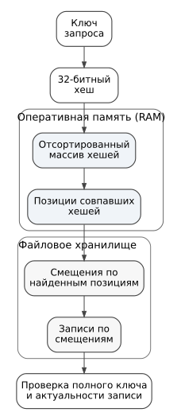
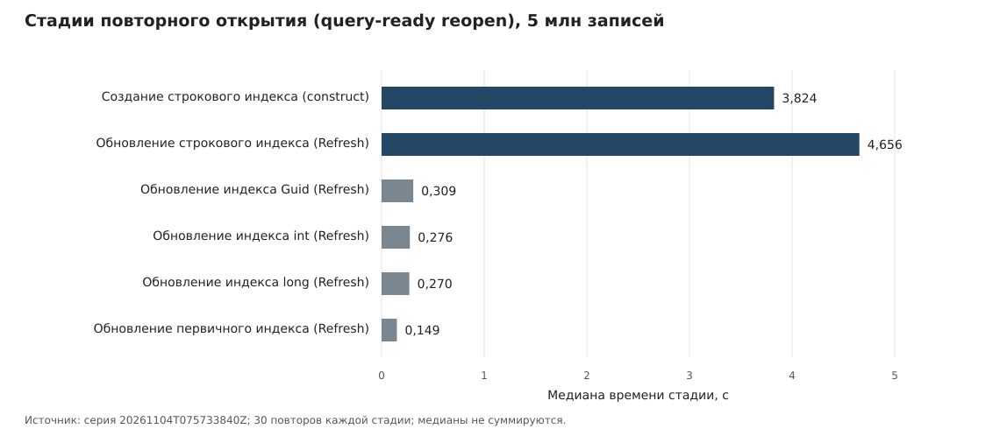

# Стоимость подготовки индексного состояния и чувствительность поиска к резидентности файлов в Polar.DB

УДК 004.65

## Аннотация

Исследованы стоимость подготовки индексного состояния Polar.DB и чувствительность поиска к резидентности файловых компонентов. Основная сравнительная серия включает 19 сценариев Polar.DB и SQLite на детерминированных наборах из 50 тыс. и 5 млн записей в Linux/WSL2/ext4. На 5 млн записей медианы пакетного поиска по первичному ключу у Polar.DB ниже для четырёх типов ключа в двух режимах подготовки. При этом построение четырёх внешних индексов занимает 12,799 с против 9,803 с у SQLite и сопровождается 12,64 ГБ управляемых выделений. Медиана полного цикла повторного открытия Polar.DB (включая проверенный запрос и последующее закрытие) составляет 9,551 с; конструирование и восстановление строкового внешнего индекса дают медианно 88,7% времени цикла. Эти сравнения описательны: физическая работа систем различается, а основная серия проведена один раз. В отдельном контролируемом опыте на 20 млн записей в восьми парных блоках вытеснение файла смещений увеличивало среднее время поиска относительно вытеснения дискового файла хешей в геометрическом среднем в 23,62 раза (95%-й bootstrap-интервал 20,83–26,31). Резидентность остальных файлов контролировалась, а подготовленная база не изменялась. Исходные измерения опубликованы; 160 числовых показателей основных таблиц независимо пересчитаны и совпали в пределах округления. Результат представляет компонентно-ориентированную экспериментальную характеристику одной архитектуры, а не новый индексный алгоритм или универсальное сравнение СУБД.

**Ключевые слова:** Polar.DB, SQLite, встраиваемая база данных, индексирование, первичный ключ, внешний индекс, Guid, повторное открытие, выделения управляемой памяти, файловый кэш, резидентность страниц, смещения записей, экспериментальная производительность.

## 1. Введение

Встраиваемые индексные хранилища следует оценивать не только по времени поиска: построение индексов, расход памяти и восстановление рабочего состояния после открытия могут определять пригодность реализации для конкретной нагрузки. Это особенно существенно там, где часть индекса размещается в оперативной памяти, а часть — в файлах: высокая скорость подготовленного поиска сама по себе не гарантирует малую стоимость создания или восстановления индексного состояния.

В основе Polar.DB лежат типизированные последовательности и специализированные индексные построения, представленные в работах [1–3]; ранее библиотека использовалась, в частности, для работы с RDF и SPARQL [4]. В текущей реализации отсортированные хеши первичных ключей хранятся в памяти, смещения — в файловом представлении, а внешние индексы поддерживают типизированный поиск по неуникальным признакам. Работы [1–3] описывают архитектурные основания Polar.DB; самостоятельный предмет настоящего исследования — измеренная стоимость операций и поведение файловых компонентов конкретной версии реализации, а не повторное представление её базовых структур.

Работы о сравнении индексных структур [5, 6] и методика SOSD [8] показывают важность состава набора данных, типа нагрузки и границ измерения. Однако SOSD исследует поиск по отсортированным данным, а не полный цикл восстановления индексного состояния; численные результаты этих работ не являются прямой базой сравнения с Polar.DB. В исследованиях дисковых learned-индексов рассмотрены выбор физической структуры и организация доступа [7, 12], а в препринте Shi и соавторов (2026) предложена модель стоимости ввода-вывода с учётом политики кэширования и распределения запросов [13]. Эти работы служат методологическим контекстом, но learned-индексы в данном стенде не реализованы и не измерялись как алгоритмические конкуренты Polar.DB. Следовательно, сама зависимость задержки от резидентности страниц, как и преимущество отдельных индексных структур на выбранной нагрузке, не является новым результатом настоящей работы. Для корректного сравнения СУБД необходимо также учитывать различия предварительной подготовки [9] и межсерийную изменчивость [10, 11].

**Исследовательский вопрос:** в каких компонентах индексного состояния Polar.DB сосредоточены измеряемые затраты на подготовку к запросу и какие файловые компоненты чувствительны к выборочному вытеснению страниц при уже подготовленном индексе? Готовность означает возможность выполнить первый проверенный запрос после восстановления индексов; измеряемый цикл `query-ready reopen` включает также последующее закрытие хранилища. Задержка дальнейших поисков рассматривается отдельно.

**Цель работы** — количественно локализовать эту стоимость в исследуемой реализации. **Эмпирический вклад:** (1) характеристика построения, подготовленного поиска и повторного открытия при 50 тыс. и 5 млн записей с раздельными временными границами; (2) локализация доминирующих стадий восстановления строкового внешнего индекса по временным отметкам и анализу кода; (3) проверка внутри Polar.DB парного контраста вытеснения файла смещений и дискового файла хешей на 20 млн записей с контролем резидентности страниц. Сравнение с заданной конфигурацией SQLite даёт контекст для первого исследования, но не служит проверкой причинности механизма или рейтингом движков. В отличие от работ [7, 12, 13], здесь не предлагаются новая индексная структура или аналитическая модель кэша. Результат позиционируется как экспериментальное исследование одной архитектуры, а не универсальный закон.

## 2. Архитектура исследуемой реализации Polar.DB

### 2.1. Типизированная последовательность и модель изменения

Базовой физической абстракцией Polar.DB является `UniversalSequenceBase`: последовательность элементов заранее заданного структурного типа, отображаемая в байтовый поток [1–3]. Поверх неё `USequence` реализует [универсальную последовательность](POLAR_DB_ARTICLE_TECHNICAL_MATERIALS.md#term-universal-sequence) как логически редактируемое представление. Физические записи преимущественно добавляются в конец, а изменение существующей логической записи не требует обязательной перезаписи её прежнего места.

Первичный ключ задаёт логическую уникальность. Добавление нового ключа создаёт новую запись; изменение существующего значения выполняется добавлением новой версии с тем же ключом; удаление — добавлением специального пустого состояния ([маркер логического удаления (tombstone)](POLAR_DB_ARTICLE_TECHNICAL_MATERIALS.md#term-tombstone)). При чтении видимой считается последняя актуальная версия ключа ([правило последней записи (last-write-wins)](POLAR_DB_ARTICLE_TECHNICAL_MATERIALS.md#term-last-write-wins)), а прежние физические версии становятся неактуальными. Тем самым вставка, изменение и удаление сводятся к одной append-oriented операции, тогда как индексы и восстановление состояния отвечают за получение актуального логического представления.

### 2.2. Первичный индекс и смешанная резидентность

Статическая часть первичного индекса строится над последовательностью и связывает первичный ключ с физическим смещением записи. Тип пользовательского ключа (`TKey` в типизированном API) и тип внутренней индексной координаты — разные понятия: независимо от того, является ключ `int`, `long`, `Guid` или `string`, текущий первичный индекс (primary index) получает из него 32-битный `int`-хеш. Тип хеша не параметризован отдельным `THash`. Для поиска в оперативной памяти удерживается отсортированный массив этих хешей (`int[]`), тогда как статические смещения (offsets) не дублируются вторым полным массивом `long[]` и остаются в хранилище с записями фиксированной длины (fixed-size storage). После определения позиции по хешу соответствующее смещение читается по индексу из этого хранилища.

Организация доступа по первичному ключу приведена на рисунке 1.

Рисунок 1 — Доступ по первичному ключу в Polar.DB: хеши в памяти, смещения в файле

На рисунке 1 показано различие между размещаемыми в оперативной памяти хешами и файловыми смещениями. При совпадении хешей необходимо проверить полные ключи; затраты этой проверки не сводятся к бинарному поиску по массиву.

При коллизии хешей сравниваются полные ключи и учитывается актуальность записи; поэтому время поиска включает дополнительные чтения, а расход памяти нельзя выводить только из размера массива хешей. Подробности промежуточных структур приведены в технических материалах.

Изменения после статического снимка образуют динамическое состояние. Оно имеет приоритет над статической частью и обеспечивает актуальность замен и логических удалений до следующего построения статического представления.

### 2.3. Типизированные внешние индексы

Внешний индекс задаёт поиск по неуникальному признаку: одному ключу может соответствовать множество записей. В исследуемой реализации используются типизированные `ExternalKeyIndex<T>` для `int`, `long`, `Guid` и `string`. Здесь `T` — именно тип пользовательского внешнего ключа, а не тип хеша. В отличие от первичного индекса (primary index), текущий `ExternalKeyIndex<T>` сортирует и сравнивает сами типизированные ключи; отдельного параметризованного типа хеша у него нет. Типизация обеспечивает проверку типов API на этапе компиляции (compile-time type checking), типизированный `IComparer<T>` и позволяет ключам значимых типов (value types) храниться в `T[]` без обязательной упаковки (boxing) каждого значения. Поиск включает нахождение диапазона равных ключей, получение смещений, проверку актуальности логического состояния и материализацию найденных записей.

В новой серии Guid хранится в нативном 16-байтовом формате; исторические результаты строкового представления отделены в технических материалах.

Эта декомпозиция означает, что задержка поиска по уже построенному внешнему индексу и стоимость его построения являются разными характеристиками. Кроме того, при выдаче тысяч или миллионов строк время запроса характеризует не только индексный поиск, но и обход с материализацией результата.

### 2.4. Обход и динамический хвост

Обход последовательности читает логически актуальные записи. После сохранения индексного снимка могут появиться новые записи — динамический хвост; при повторном открытии он должен быть учтён при восстановлении текущего логического состояния. Детали реализации обхода и отдельный эксперимент с хвостом приведены в технических материалах.

### 2.5. Открытие и подготовка состояния готовности к запросам (query-ready)

Открытие файлов и готовность к индексному запросу являются разными стадиями жизненного цикла. В анализируемом сценарии `open-only` **не является изолированным временем файловых дескрипторов**: вызов фабрики конструирует последовательность, первичный индекс и четыре внешних, а конструкторы могут читать и восстанавливать состояние. Более точное название этой стадии — `constructor-open-only`. `query-ready reopen` дополнительно включает подготовку индексного состояния, один проверяемый поиск и завершающее закрытие хранилища. В текущей серии дополнительно измерены проба открытия только файловых дескрипторов и временны́е отметки конструкторов, первичного и каждого внешнего индекса, `Refresh`, первого запроса и закрытия.

В основном опыте повторного открытия Polar.DB создаёт хранилище с первичным индексом и четырьмя типизированными внешними индексами. Поэтому стоимость `Refresh()` и объём памяти открытого хранилища (live-memory footprint) рассматриваются как отдельные исследуемые характеристики, а не как накладные расходы, автоматически амортизируемые каждым приложением.

**Неравные физические границы готовности.** В Polar.DB перед первым проверенным первичным запросом стенд вызывает `Refresh()` для первичного и четырёх внешних индексов. В SQLite повторное открытие использует ранее сохранённые дисковые индексы, однако измеряемый цикл включает конструирование и открытие соединения, первый проверенный *первичный* запрос и закрытие соединения; отдельный запрос к внешним индексам после открытия в этом сценарии не измеряется. Таким образом, сопоставляется длительность полного цикла, включающего проверенный первичный запрос и закрытие, при одинаковом логическом *наборе* индексов, но **не** одинаковая физическая работа по их восстановлению и **не** стоимость подготовки к проверенному внешнему запросу. Отношение полученных времен нельзя представлять как универсальное ускорение одного алгоритма повторного открытия относительно другого.

## 3. Экспериментальная методика

### 3.1. Сравниваемые реализации

Исследуется фиксированная реализация Polar.DB; её точная версия и исходные данные измерений указаны в материалах воспроизводимости. Контрольной системой служит SQLite 3.53.3 через `Microsoft.Data.Sqlite` 9.0.4. SQLite выбран как зрелая встраиваемая файловая СУБД, доступная из того же .NET-процесса, но не рассматривается как универсальный эталон.

Сравнивается одинаковый внешний результат операции, а не одинаковое внутреннее устройство. Polar.DB и SQLite различаются форматами, индексными структурами, использованием оперативной памяти и механизмами фиксации; эти различия являются частью сравниваемых реализаций. Для SQLite стенд использует WAL, явно создаёт требуемые индексы и применяет параметризованные подготовленные запросы. Семантика WAL и контрольных точек определяется документацией SQLite (ссылки приведены в материалах воспроизводимости); она необходима для точного описания измеряемой границы сохранения, но не составляет научную новизну работы. Систематический подбор настроек SQLite за пределами фиксированного протокола не выполнялся. Поэтому результаты относятся к **выбранной конфигурации**, а не к лучшей возможной производительности SQLite [9].

**Сопоставимость профиля индексов.** В исторической серии `linux-wsl2-ext4-20261010` SQLite создавал три дополнительные уникальные структуры индексов в опытах добавления и удаления, что ограничивало сопоставимость. Новая серия построена по исправленному сценарию: для `AppendOnly`, `DeleteOnly` и `ReopenOnly` обе системы обслуживают один первичный и четыре неуникальных внешних индекса. Для остальных типов запросов профиль создаётся по исследуемому ключу; SQLite проверяет состав индексов через `PRAGMA index_list`. Совпадение состава не означает одинаковые внутренние структуры, объём подготовки или гарантии фиксации. SQLite удаляет строку, а Polar.DB добавляет tombstone; время этих операций характеризует разные физические механизмы.

**Границы сравнения по классам операций.** Для точечного поиска фиксируются успешные запросы и получение одной логической записи; для неуникального внешнего поиска измеряется также получение и обработка всех найденных строк, число которых задано селективностью. Для `Build` фиксируются именованные стадии соответствующих реализаций, а не универсальная стоимость построения эквивалентных физических структур; `Load` и `Flush` разграничены отдельно. Для `ReopenOnly` измеряется полный цикл конструирования, подготовки, первого проверенного *первичного* запроса и закрытия; Polar.DB при этом восстанавливает все четыре внешних индекса, тогда как SQLite использует сохранённые дисковые структуры. Добавление и удаление различаются способом поддержания истории. Поэтому исходные таблицы рассматриваются как сравнение реализаций при заданных сценариях, а не как строгая оценка превосходства одного алгоритма над другим.

### 3.2. Модельные данные

Основные сценарии используют 50 000 и 5 000 000 детерминированно сгенерированных записей. Каждая запись содержит первичные ключи типов `int`, `long`, `Guid` и `string`, четыре соответствующих поля внешнего ключа и строковую полезную нагрузку.

Для обычного внешнего ключа число различных значений выбрано так, что успешный запрос возвращает приблизительно 50 строк на массиве 50 тыс. и 5000 строк на массиве 5 млн. Для высокочастотного ключа одному значению соответствует 40% массива: 20 000 и 2 000 000 строк соответственно. Последний вариант является преднамеренно тяжёлым сценарием материализации, а не моделью типичной селективности.

**Состав выборки запросов.** В экспериментальном `LookupPlanner` ключи извлекаются из реально существующих записей; для частотных сценариев используется заранее заданный ключ с совпадениями. Таким образом, результаты основной серии характеризуют **успешные** запросы на детерминированных синтетических данных. Отдельного измерения отсутствующих ключей, случайно варьируемых распределений, а также реальных наборов разных структур не проводилось. В исследовании Bellomo и соавторов [6] эти факторы рассматриваются раздельно и могут менять характеристики индекса.

### 3.3. Набор сценариев

Основная серия содержит 19 сценариев, измеренных для обоих размеров массива: поиск по первичным и неуникальным внешним индексам (включая выдачу 40% записей), построение индексов, полный логический обход, добавление и удаление, а также повторное открытие с динамическим хвостом и без него. В основной рукописи подробно рассматриваются поиск, построение, память и восстановление индексного состояния. Отдельная серия на 20 млн записей исследует влияние файлового кэша на поиск по первичному ключу и не объединяется с основной серией. Вспомогательные результаты изменения данных и обхода с хвостом вынесены в [технические материалы](POLAR_DB_ARTICLE_TECHNICAL_MATERIALS.md#additional-results-20261104). Схема логических состояний и подробный протокол стадий также приведены там.

### 3.4. Выборки времени и ресурсные метрики

Сценарии поиска (lookup) разделены на фазу без специального разогрева и подготовленную фазу. Для поиска по первичному ключу (primary-key lookup) используются пакетные измерения среднего времени запроса (batch-average samples) и отдельные измерения задержки запросов (latency samples); поэтому в результатах отдельно приводятся медиана пакетного среднего времени и медиана/95-й процентиль задержки отдельных запросов (median/p95 latency). Для поиска по внешнему индексу (secondary-index lookup) размер пакета (batch) подбирается так, чтобы измерять сопоставимый объём возвращаемых строк.

Сценарии жизненного цикла (lifecycle benchmarks) используют отдельные разогревочные и измеряемые повторы (warm-up and measured repetitions). Построение первичного индекса выполняется как 3 разогревочных + 15 измеряемых повторов, внешнего индекса — 2 + 10, обход — 2 + 10, повторное открытие — 5 + 30, добавление/удаление — 200 разогревочных + 2000 измеряемых операций без фиксации (volatile mutation); изменение с фиксацией по заданному протоколу (durable mutation) измеряется пакетами по 100 операций. **Это внутрисерийные измерения, а не независимые репликации эксперимента:** они зависят от одного процесса, подготовленного набора и состояния кэшей. Аналогично 2000 измерений задержки отдельных поисковых запросов не эквивалентны 2000 независимым запускам. Выборочный p95 этих задержек характеризует фиксированную тестовую нагрузку и не является верхней доверительной границей или оценкой эксплуатационного p95 для иных распределений запросов.

Для стадий `Load`/`Build` дополнительно фиксируются выделения управляемой памяти во всём процессе (process-wide managed allocated bytes) и изменения количества сборок мусора поколений Gen0/Gen1/Gen2. Для сценариев построенного и готового к запросам хранилища (built/query-ready store) до его закрытия снимается снимок ресурсов (resource snapshot): управляемая память (managed bytes), частная виртуальная память процесса (private bytes) и резидентный набор страниц (working set). Эти показатели различаются: суммарный объём выделений памяти (allocation volume) не равен объёму удерживаемой памяти (retained memory), а разовый снимок (snapshot) не устанавливает пиковое потребление памяти (peak memory).

Непрерывный профиль пикового потребления RAM и зависимость задержки от доступного объёма RAM в основной серии не измерялись.

Raasveldt и соавторы [9] на примерах показывают, что нарушения сопоставимости в бенчмарках СУБД способны создавать видимое преимущество одной реализации даже при отсутствии реального выигрыша. Применительно к настоящему исследованию это требует отдельно контролировать границы предварительной обработки, конфигурации индексов, настройки движков, состояние кэшей и корректность результатов.

Методология независимых повторений и анализа иерархических источников изменчивости обсуждается у Kalibera и Jones [10]. Исследование Mytkowicz и соавторов [11] показывает, что детали организации измерительного окружения способны приводить к систематическому смещению результатов. Эти работы обосновывают контроль границ измерения, порядка запуска и оценки неопределённости, однако сами по себе не подтверждают статистическую значимость сравнений Polar.DB в данной серии.

Результаты основной серии описываются медианами без межсерийных доверительных интервалов. Подготовленные планы будущих независимых повторений не являются выполненными экспериментами.

### 3.5. Изоляция процессов и контроль корректности

Координатор запускает Polar.DB и SQLite в отдельных дочерних процессах. Для каждой фазы вычисляются ожидаемые число строк и контрольная сумма. В новой серии все 220 сопоставлений успешно прошли проверку; зафиксированы 124 набора измерений и 38 исходных файлов рабочих процессов. Отдельные запросы внутри одного процесса не являются независимыми повторениями всей серии. В сценариях поиска независимый от движков эталон ожидаемых результатов (correctness oracle) формируется по исходному массиву для запрошенных ключей, а замеры включают получение строк и вычисление контрольной суммы. Однако отметка `OK` в отчёте сама по себе не достаточна: корректность публикационной серии должна подтверждаться отдельной валидацией исходных JSON и проверкой манифестов. Кроме того, в `BuildPrimaryIntOnly` итоговый `Rows/Checksum` берётся непосредственно из входного массива, а не из контрольного чтения построенного первичного индекса. Поэтому успешная проверка числа строк и контрольных сумм в 19 сценариях не является независимым доказательством правильности всех построенных индексных структур. Оригинальный архив основной серии теперь опубликован: все 160 числовых показателей таблиц 1–9 независимо пересчитаны по исходным CSV/JSON и совпали с опубликованными значениями в пределах округления. Эта проверка арифметической воспроизводимости не является независимым повторением самих измерений.

### 3.6. Среда основной серии
Основная серия (4 ноября 2026 г.) выполнена в Linux / WSL2 на файловой системе ext4; среда — Ubuntu 24.04.4 LTS, 12 доступных логических процессоров, .NET Runtime 10.0.11 и SDK 10.0.400. Использована оптимизированная сборка Release, Server GC отключён. Исходники зафиксированы коммитом `abbb03cdc34cff1c11e7550494f65b03dad9afd1`; идентификатор серии — `20261104T075733840Z`. Исходные измерения и манифесты опубликованы в оригинальном архиве; все 19 координаторов и 38 рабочих процессов фиксируют `gitDirty=false` и тот же SHA исходников. Расхождение с пометкой `source-worktree: dirty` в `SOURCE.txt`, созданном при упаковке, отдельно оговорено в материалах воспроизводимости.

Применение WSL2 характеризует виртуализированную среду Linux, поэтому результаты нельзя автоматически переносить на физический сервер Linux или непосредственно сравнивать с измерениями Windows. Версии реализации, описание среды и исходный архив серии приведены в разделе «Материалы воспроизводимости».

### 3.7. Обработка результатов и представление статистик

Для каждого сочетания сценария, числа исходных записей, СУБД, фазы и метрики медиана вычисляется по соответствующим значениям `value` из исходных CSV. Время пакетного среднего (`lookup-batch-average`) не смешивается с индивидуальной задержкой (`lookup-latency`). Для индивидуальных задержек в таблице 1 дополнительно приведён p95, вычисленный линейной интерполяцией соседних элементов отсортированной выборки. Медианы парных систем сравниваются как отдельные величины; отношение медиан, если используется, не равно медиане попарных отношений.

Медианы стадий `Load`, `Build`, `Flush` и `Build + flush` берутся из их собственных измерений. Сумма медиан не считается медианой сквозного перехода. Конверсия единиц производится до округления: 1 мс = 1000 мкс, 1 с = 1000 мс, 1 МБ = 10⁶ байт, 1 ГБ = 10⁹ байт. Диаграмма стадий открытия построена от нуля с линейной осью; числовые выборки сохранены в архиве серии.

Повторные значения внутри одного экспериментального запуска не считаются независимыми реализациями эксперимента. Поэтому графики и таблицы описывают медианы в данной среде без межсерийных доверительных интервалов или утверждения статистической значимости различий.

### 3.8. Отдельный эксперимент с управляемой резидентностью файлов

Чтобы отделить влияние смещений первичного индекса от влияния данных и хешей, проведена **отдельная серия** на 20 млн детерминированных записей с ключом `int`. База создавалась заранее и проверялась по SHA-256 до и после измерений; в фазе поиска записи и индексы не перестраивались. Для всех условий использовалась одна последовательность из 12 500 уникальных псевдослучайных ключей: 500 для разогрева, 10 000 для пакетного измерения и 2000 непересекающихся ключей для индивидуальной задержки. Последовательность покрывает все 400 диапазонов по 50 тыс. записей. Это контролируемая нагрузка успешного поиска, а не модель распределения запросов реального приложения.

В каждом из восьми отдельно запущенных парных блоков на одном хосте, одной базе и одном потоке ключей измерены шесть условий: Polar.DB со всеми файлами в RAM, с отдельно вытесненными хешами (`f1.bin`), смещениями (`f2.bin`) или данными (`f0.bin`); SQLite со всеми страницами в RAM и с вытесненным файлом базы. Порядок запусков задан заранее, в соседних блоках используется обратный порядок. В каждом случае выполняется отдельный процесс в контейнере Linux с лимитом RAM **8 ГиБ**, отключённым swap и разрешённым закреплением до **3 ГиБ**. До открытия базы `mmap` и `mlock` закрепляют страницы файлов; непосредственно перед измерением выбранный файл освобождается (`munlock`/`munmap`) и для него вызывается `POSIX_FADV_DONTNEED`. Остальные страницы удерживаются в памяти до конца измерения. Состояние каждого файла подтверждается через `mincore` до воздействия, перед пакетом запросов и после него.

Основной показатель отдельного запуска — среднее время одного запроса в пакете из 10 000 поисков (100 групп по 100 запросов). **Первичное сравнение выполняется попарно внутри блока:** отношение этого среднего при вытеснении `f2.bin` к среднему при вытеснении `f1.bin`. Для восьми отношений рассчитывается геометрическое среднее и двусторонний 95%-й процентильный bootstrap-интервал по блокам (10 000 перевыборок); запросы внутри блока не считаются независимыми экспериментами. Критерий подтверждения серии 4B — минимум шесть корректных пар из восьми и нижняя граница интервала больше единицы — зафиксирован до её измерений, но после предшествующих пилотных исследований. Это подтверждающая серия в рамках данной истории эксперимента, а не исходная гипотеза, сформулированная до любой разведочной работы. Условия допустимости включают проверку контрольных сумм, размера закреплённых файлов, резидентности выбранных и остальных основных файлов, а также отсутствие OOM и достижения лимита RAM. Увеличение времени или числа чтений само по себе не является причиной исключения. Подробная процедура и значения восьми пар приведены в [материалах отдельной серии](PRIMARY_OFFSET_RESIDENCY_20261107.md).

## 4. Результаты

### 4.1. Поиск по первичному ключу

В таблице 1 приведены результаты новой основной серии на 5 млн записей. Медиана пакетного среднего времени и медиана/p95 индивидуальной задержки — разные статистики. Все значения переведены из исходных миллисекунд в микросекунды.

Таблица 1 — Поиск по первичному ключу на 5 млн записей, мкс/запрос

| Ключ | Режим | Polar.DB, пакет | SQLite, пакет | Polar.DB, задержка (мед./p95) | SQLite, задержка (мед./p95) |
|---|:---|---:|---:|---:|---:|
| `int` | без специального разогрева | 3,412 | 9,735 | 3,1 / 4,0 | 8,6 / 12,7 |
| `int` | после разогрева | 3,746 | 4,864 | 3,6 / 5,4 | 4,5 / 6,8 |
| `long` | без специального разогрева | 3,258 | 9,213 | 3,1 / 4,3 | 7,9 / 34,9 |
| `long` | после разогрева | 3,691 | 9,892 | 3,5 / 4,1 | 6,2 / 15,2 |
| `Guid` | без специального разогрева | 3,050 | 13,153 | 2,8 / 4,2 | 15,5 / 29,9 |
| `Guid` | после разогрева | 3,548 | 7,624 | 4,9 / 7,0 | 6,6 / 8,5 |
| `string` | без специального разогрева | 7,855 | 10,184 | 6,1 / 10,7 | 8,0 / 12,0 |
| `string` | после разогрева | 3,628 | 6,922 | 3,1 / 5,3 | 6,5 / 10,2 |

Во всех восьми сочетаниях типа ключа и режима медиана пакетного среднего времени Polar.DB ниже соответствующей медианы SQLite. Условие «без специального разогрева» означает отсутствие управляемого прогрева на уровне приложения после повторного открытия, но не гарантирует холодный файловый кэш ОС. Значения описывают один запуск серии; индивидуальные запросы внутри worker не являются независимыми повторениями всей постановки.

### 4.2. Поиск по внешнему неуникальному индексу

В таблице 2 сопоставляется поиск по заранее построенному внешнему индексу. При 5 млн записей один успешный запрос возвращает около 5000 строк; время включает получение и обработку результатов. Показана медиана пакетного среднего времени в миллисекундах на запрос.

Таблица 2 — Поиск по внешнему индексу на 5 млн записей

| Ключ | Polar.DB без разогрева, мс | SQLite без разогрева, мс | Polar.DB после разогрева, мс | SQLite после разогрева, мс |
|---|---:|---:|---:|---:|
| `int` | 12,099 | 16,179 | 11,340 | 16,001 |
| `long` | 12,652 | 14,942 | 11,835 | 14,983 |
| `Guid` | 10,882 | 15,759 | 10,397 | 14,878 |
| `string` | 12,010 | 18,546 | 10,893 | 14,437 |

Во всех восьми сочетаниях «тип × режим» медиана времени Polar.DB ниже соответствующей медианы SQLite. Это сравнение *чтения по уже существующему индексу*, а не стоимости его построения.

В таблице 3 приведён преднамеренно тяжёлый сценарий: один внешний ключ соответствует 40% записей, поэтому на 5 млн исходных строк материализуются 2 млн результатов. Единица времени — секунда на запрос, а не миллисекунда.

Таблица 3 — Высокочастотная выборка по внешнему индексу на 5 млн записей

| Ключ | Polar.DB без разогрева, с | SQLite без разогрева, с | Polar.DB после разогрева, с | SQLite после разогрева, с |
|---|---:|---:|---:|---:|
| `int` | 3,526 | 3,813 | 3,431 | 3,801 |
| `long` | 3,369 | 3,817 | 3,360 | 3,854 |
| `Guid` | 3,132 | 3,932 | 3,034 | 3,935 |
| `string` | 3,745 | 4,338 | 3,612 | 4,090 |

При таком размере выдачи время определяется не только поиском ключа, но и обходом и материализацией миллионов записей. В новой серии на 5 млн записей в восьми сочетаниях «тип × режим» наблюдаемая медиана Polar.DB ниже соответствующей медианы SQLite. При 50 тыс. записей и меньшем объёме выдачи после разогрева направление противоположно (таблица 9).

### 4.3. Построение первичного и внешних индексов

В таблице 4 показана внутренняя измеренная стадия `Build` первичного индекса Int32. Время `Load`, в рамках которого Polar.DB уже подготавливает пары «хеш — смещение», в эти значения не входит. Объём выделений управляемой памяти относится только к стадии `Build`. Во всех таблицах МБ и ГБ рассчитаны десятичным способом (10⁶ и 10⁹ байт соответственно).

Таблица 4 — Построение первичного индекса Int32

| Записей | Polar.DB Build, мс | SQLite Build, мс | Выделения Polar.DB, МБ | GC Gen0/1/2 | Прирост управляемой памяти, МБ |
|---|---:|---:|---:|---:|---:|
| 50 000 | 14,547 | 13,556 | 0,7 | 0/0/0 | 0,2 |
| 5 000 000 | 165,089 | 1679,446 | 60,1 | 0/0/0 | 20,0 |

При 5 млн записей медиана стадии `Build` в Polar.DB составляет 165,089 мс, выделения — около 60,1 МБ при нулевой медиане сборок мусора внутри этой стадии. Прирост управляемой памяти близок к 20 МБ, что согласуется с размещением массива 5 млн 32-битных хешей в оперативной памяти. Однако `Load` на том же объёме имеет медиану 309,255 мс и выделяет около 468,4 МБ. Поэтому отношения времени `Build` разных движков не следует трактовать как отношения стоимости полной подготовки базы: границы внутренней работы различаются.

В таблице 5 приведены измерения построения четырёх внешних индексов поверх заранее подготовленного хранилища. В отличие от предыдущей серии, сценарий успешно выполнен для 5 млн строк. `Build + flush` включён как отдельный измеренный показатель, не вычисленный суммой медиан стадий.

Таблица 5 — Построение четырёх внешних индексов

| Записей | Polar.DB Build, мс | SQLite Build, мс | Polar.DB Build + flush, мс | SQLite Build + flush, мс | Выделения Polar.DB, ГБ | Сборки GC Gen0/1/2 |
|---|---:|---:|---:|---:|---:|---:|
| 50 000 | 124,622 | 83,208 | 124,669 | 100,605 | 0,125 | 13/1/1 |
| 5 000 000 | 12799,443 | 9803,192 | 12799,864 | 9851,584 | 12,641 | 1187/76/1 |

На 5 млн записей медиана `Build` составляет 12,799 с у Polar.DB и 9,803 с у SQLite. В Polar.DB за стадию суммарно выделяется около 12,64 ГБ управляемой памяти, при медианах 1187/76/1 сборок GC Gen0/1/2. Это *совокупные выделения за время операции*, а не пик использования физической памяти. Затраты на построение внешних индексов существенно отличаются от стадии построения первичного индекса; сравнение с исторической серией на 500 тыс. без учёта версии кода некорректно.

### 4.4. Последовательный обход

На массиве из 5 млн записей медиана полного логического обхода составила **2,025 с у Polar.DB против 7,934 с у SQLite** (на 50 тыс. — 47,111 и 78,627 мс соответственно). Этот результат характеризует чтение подготовленной последовательности, а не стоимость построения её индексов. Измерения повторного открытия с динамическим хвостом приведены отдельно в [таблице Д.1 технических материалов](POLAR_DB_ARTICLE_TECHNICAL_MATERIALS.md#supp-table-d1); границы этих операций различаются между системами.

### 4.5. Повторное открытие и память открытого хранилища

`ReopenOnly` использует первичный и четыре внешних индекса. В таблице 6 показаны медианы двух отдельно измеренных полных циклов: конструирование с закрытием объектов (`constructor-open-only`) и конструирование с подготовкой индексов, первым проверенным поиском и последующим закрытием (`query-ready reopen`). Значение `open-only` нельзя считать временем открытия одних файловых дескрипторов. Разность медиан не равна длительности отдельного `Refresh()`. Таймер обоих циклов включает закрытие: при 5 млн записей медиана стадии `close` составляет 6,091 мс для Polar.DB и 0,044 мс для SQLite; следовательно, значение `query-ready reopen` нельзя выдавать за изолированное время до первого ответа.

Таблица 6 — Время повторного открытия хранилища

| Записей | Polar.DB open-only, мс | SQLite open-only, мс | Polar.DB query-ready, мс | SQLite query-ready, мс |
|---|---:|---:|---:|---:|
| 50 000 | 71,053 | 0,025 | 126,642 | 0,190 |
| 5 000 000 | 3673,870 | 0,024 | 9550,653 | 0,204 |

На 5 млн записей медиана `constructor-open-only` у Polar.DB — около 3,67 с, а `query-ready reopen` — около 9,55 с. Чтобы локализовать измеренную стоимость, в таблице 7 приведены медианы внутренних стадий из 30 повторов каждого размера массива. Порядок четырёх внешних индексов в коде стенда — `int`, `long`, `Guid`, `string`; поэтому метрика `construct-external-3` соответствует строковому индексу. Значения стадий относятся к своему режиму измерения: отдельная проба файловых дескрипторов не входит в цикл `open-only`, а медианы составляющих нельзя складывать как медиану полного цикла. Источники измеряемых границ — [цикл Polar.DB](https://github.com/Sergey303/Polar.DB/blob/abbb03cdc34cff1c11e7550494f65b03dad9afd1/benchmarks/src/BenchSupport/PolarLifecycleEngine.cs) и [цикл SQLite](https://github.com/Sergey303/Polar.DB/blob/abbb03cdc34cff1c11e7550494f65b03dad9afd1/benchmarks/src/BenchSupport/SqliteLifecycleEngine.cs) экспериментального стенда.

Таблица 7 — Диагностика повторного открытия Polar.DB по стадиям, медианы, мс

| Измеряемый этап | 50 000 записей | 5 000 000 записей |
|:---|---:|---:|
| Открытие/закрытие файлов (отдельная проба) | 0,0393 | 0,02645 |
| Строковый индекс: конструирование в `open-only` | 63,873 | 3667,113 |
| Строковый индекс: конструирование в `query-ready` | 43,201 | 3823,987 |
| `Refresh` первичного индекса | 1,432 | 149,124 |
| `Refresh` внешнего `int` | 3,609 | 275,537 |
| `Refresh` внешнего `long` | 4,902 | 270,364 |
| `Refresh` внешнего `Guid` | 5,080 | 308,933 |
| `Refresh` внешнего `string` | 50,255 | 4655,558 |
| Первый проверенный поиск по первичному ключу | 0,051 | 0,045 |

Две наиболее продолжительные стадии `query-ready reopen` при 5 млн записей связаны со строковым внешним индексом: создание объекта — 3823,987 мс, `Refresh` — 4655,558 мс. При вычислении отношения **по каждому из 30 парных повторов** их суммарное время составляет медианно 88,7% полной длительности цикла (диапазон долей 30 повторов: 84,7–90,0%); на 50 тыс. записей — 75,4%. Это медиана долей отдельных повторов, **не** доля суммы приведённых в таблице медиан. Открытие и закрытие файловых дескрипторов в отдельной пробе занимает 0,02645 мс при 5 млн записей; оно не объясняет многосекундное время создания индексного состояния. Последовательность вызовов проверена по исходникам версии `abbb03c`: при конструировании [`ExternalKeyIndex<string>`](https://github.com/Sergey303/Polar.DB/blob/abbb03cdc34cff1c11e7550494f65b03dad9afd1/src/Polar.DB/ExternalKey/ExternalKeyIndex.cs) открывает строковый файл через [`OpenIndexSequence`](https://github.com/Sergey303/Polar.DB/blob/abbb03cdc34cff1c11e7550494f65b03dad9afd1/src/Polar.DB/UniversalSequenceBase.cs), для которого отключено отдельное сохранение контрольной точки. Для последовательности переменных строк конструктор восстанавливает границу данных проходом по записям. Затем `Refresh()` вновь проверяет хранилище и [`ReadSnapshot`](https://github.com/Sergey303/Polar.DB/blob/abbb03cdc34cff1c11e7550494f65b03dad9afd1/src/Polar.DB/ExternalKey/ExternalKeyIndexCompaction.cs) загружает ключи и смещения в массивы. Это **установленный по коду механизм** повторного прохода и материализации, согласующийся с наблюдаемым распределением времени; **доля конкретных низкоуровневых операций в общей задержке отдельно не измерялась**. Текущая серия не отделяет затраты на декодирование строк, выделение памяти и обращения к накопителю.

На рисунке 2 приведены стадии цикла `query-ready reopen` на 5 млн записей: горизонтальные шкалы начинаются с нуля, показаны медианы времени каждой операции. Они служат диагностикой, а не арифметическим разложением медианы полного цикла.

Рисунок 2 — Выбранные внутренние стадии цикла `query-ready reopen` Polar.DB, 5 млн записей; медианы, с

**Отдельная проверка после основной серии.** 5 ноября 2026 года на том же SHA `abbb03c` выполнен дополнительный запуск `ReopenOnly` с одним разогревочным и тремя измеряемыми повторами для каждого из двух размеров массива. На 5 млн строк медиана `query-ready reopen` у Polar.DB составила 11,859 с, а медиана парных долей конструирования и `Refresh` строкового внешнего индекса — 88,7%; при 50 тыс. строк — 144,536 мс и 68,1% соответственно. Выполнение происходило с .NET Runtime 10.0.12 вместо 10.0.11 и без строгого контроля состояния файлового кэша и фоновой нагрузки. Результаты **не объединены** с таблицами основной серии: повторение доминирующих стадий не подтверждает равенства абсолютных времён, а три повтора не задают межсерийную неопределённость. Исходные CSV/JSON, манифесты и проверка пересчёта доступны в [отдельном протоколе диагностического запуска](REOPEN_DIAGNOSTIC_20261105.md).

Для интерпретации памяти в таблице 8 приведён разовый снимок процесса с открытым хранилищем, а не максимальное значение RAM в ходе работы.

Таблица 8 — Память открытого хранилища Polar.DB (снимок процесса)

| Записей | Managed, ГБ | Managed delta, ГБ | Private, ГБ | Working set, ГБ |
|---|---:|---:|---:|---:|
| 50 000 | 0,022 | 0,008 | 0,153 | 0,112 |
| 5 000 000 | 2,222 | 0,899 | 3,153 | 3,051 |

На 5 млн записей снимок фиксирует около 2,22 ГБ управляемой памяти Polar.DB; прирост относительно начального снимка — около 0,90 ГБ. Эти значения согласуются с расходами на восстановление индексного состояния, но не являются профилем пикового потребления памяти. Стадии файловых дескрипторов, конструкторов, подготовки первичного и внешних индексов имеют отдельные диагностические метрики (таблица 7); не следует арифметически вычитать медианы разных циклов.

### 4.6. Массовая выборка на 50 тыс. записей

На 50 тыс. записей поиск по первичному и обычному внешнему индексу в измеренных режимах имеет меньшие медианы у Polar.DB; полные данные приведены в [таблицах Д.3–Д.4 технических материалов](POLAR_DB_ARTICLE_TECHNICAL_MATERIALS.md#additional-results-20261104). Неожиданное изменение направления возникает при высокочастотной выдаче 20 тыс. результатов.

Таблица 9 — Высокочастотный поиск по внешнему индексу на 50 тыс. записей, мс/запрос

| Тип ключа | Polar.DB без разогрева | SQLite без разогрева | Polar.DB после разогрева | SQLite после разогрева |
|:---|---:|---:|---:|---:|
| `int` | 49,660 | 68,231 | 69,832 | 39,453 |
| `long` | 47,127 | 62,182 | 52,957 | 41,154 |
| `Guid` | 39,926 | 64,196 | 48,448 | 38,482 |
| `string` | 52,619 | 67,714 | 83,737 | 41,317 |

Без специального разогрева медианы Polar.DB ниже во всех четырёх типах ключа, после разогрева — ниже у SQLite. На 5 млн записей при выдаче 2 млн строк направление в обоих режимах меняется в пользу Polar.DB (таблица 3). Одновременно изменяются размер массива и объём материализуемого результата; выделить причину без дополнительного опыта нельзя.

### 4.7. Резидентность файлов первичного индекса на 20 млн записей

В таблице 10 приведены результаты **отдельной серии 4B**, отличной от основной по объёму данных, способу управления файловым кэшем и структуре повторений. Для каждого условия указано среднее из восьми средних времен поиска по 10 000 запросов. Это описательные значения отдельных условий; для проверки гипотезы использовано **парное** сравнение внутри каждого блока.

Таблица 10 — Поиск по первичному ключу `int` при управляемой резидентности файлов на 20 млн записей

| Система и состояние файлов | Принято / выполнено | Среднее время, мкс/запрос | Чтение процесса за пакет, МБ |
|:---|---:|---:|---:|
| Polar.DB: все файлы закреплены в RAM | 8/8 | 11,793 | 0,000 |
| Polar.DB: вытеснены хеши `f1.bin` | 8/8 | 9,017 | 0,002 |
| Polar.DB: вытеснены смещения `f2.bin` | 8/8 | 210,689 | 93,250 |
| Polar.DB: вытеснены записи `f0.bin` | 8/8 | 230,837 | 81,142 |
| SQLite: файл базы закреплён в RAM | 8/8 | 19,167 | 0,001 |
| SQLite: файл базы вытеснен | 8/8 | 249,257 | 46,850 |

**Все 48 запланированных запусков приняты.** Отношение времени поиска Polar.DB при вытеснении смещений к времени поиска при вытеснении файла хешей составило в геометрическом среднем по восьми парным блокам **23,62** (двусторонний **95%-й перцентильный bootstrap-интервал 20,83–26,31**). Средняя по восьми парам абсолютная разность времени составила **201,672 мкс/запрос**. Во всех восьми парах наблюдается увеличение времени; заданный до измерений критерий подтверждения выполнен. Это не отношение производительности Polar.DB и SQLite и не сравнение двух реализаций одного алгоритма.

Наблюдение согласуется с путём поиска в [`UKeyIndex`](https://github.com/Sergey303/Polar.DB/blob/a11457ce502b416041ea7bde0b53d2dc047db491/src/Polar.DB/UKeyIndex.cs): отсортированные хеши доступны в памяти через `hkeys_arr`, затем смещение читается через `offsets.GetByIndex(pos)`, а запись — через `sequence.GetByOffset(...)`. Поэтому вытеснение *дискового представления* хешей `f1.bin`, уже загруженных в `hkeys_arr`, служит контрольным вмешательством, но **не** эталоном полностью холодного или полностью прогретого индекса. Вытеснение читаемого в пути поиска файла смещений `f2.bin` при резидентных данных связано с существенно большей задержкой и объёмом чтений. Размеры и роль файлов различаются: отношение 23,62 характеризует именно **контраст двух воздействий**, а не чистое отношение «кэш включён/выключен». Среднее в условии с вытесненными хешами (9,017 мкс) численно ниже полностью закреплённого (11,793 мкс), но схема проверки не устанавливает, что вытеснение хешей ускоряет поиск; этот побочный контраст не был основной проверяемой гипотезой. Счётчик `read_bytes` относится ко **всему процессу**, а не к конкретному файлу. Все восемь пар, идентификаторы версий и контрольные суммы приведены в [протоколе серии](PRIMARY_OFFSET_RESIDENCY_20261107.md).

**Дополнительный апостериорный анализ, не входивший в предварительно зафиксированную гипотезу.** Точный поток измеряемых 10 000 ключей, восстановленный по исходному алгоритму с совпадающим SHA-256, при используемом хешировании обращается к **8861 различной странице** файла смещений размером 4 КиБ (минимум **36,295 МБ** страниц). После измерения с предварительным вытеснением `f2.bin` средний прирост резидентности этого файла по восьми блокам составил **22 570 страниц**, или **92,447 МБ**: примерно **2,55 раза** больше множества страниц, необходимых самим запросам. Прирост общепроцессного счётчика `read_bytes` за пакет составил **93,250 МБ**. Это наблюдение указывает на возможность загрузки дополнительных страниц сверх непосредственно затронутых ключами; однако само по себе **не устанавливает**, какая доля вызвана упреждающим чтением ядра, особенностями `FileStream` или другими чтениями процесса, и не доказывает эффективность иной реализации доступа. Расчёт доступен в [воспроизводимом анализаторе](../scripts/analyze_stage4b_offset_io.py); новые бенчмарки для него не выполнялись.

### 4.8. Обсуждение результатов

В измеренной конфигурации Polar.DB показывает меньшие медианы подготовленного поиска по четырём типам первичного ключа и обычного внешнего поиска на 5 млн записей (таблицы 1–2). Время полного обхода также ниже. Однако построение четырёх внешних индексов занимает 12,799 с против 9,803 с у SQLite и сопровождается 12,64 ГБ управляемых выделений (таблица 5). Это не пиковая память процесса: снимок при открытом хранилище фиксирует 2,222 ГБ управляемой памяти (таблица 8).

Основная стоимость повторного открытия Polar.DB локализована в двух стадиях строкового внешнего индекса: 3,824 с на конструирование и 4,656 с на `Refresh` при медиане парной доли 88,7% (таблица 7, рисунок 2). По исходному коду конструирование включает восстановление границ записей переменной длины, а `Refresh` читает ключи и смещения в резидентные массивы. Это объясняет состав выполняемой работы, но ещё не разделяет её время между декодированием, аллокациями и вводом-выводом. В измеренном цикле SQLite не выполняет аналогичную загрузку всех внешних индексов в память, поэтому соотношение абсолютных времён открытия нельзя считать ускорением эквивалентного алгоритма.

Смена направления сравнения при высокочастотной выборке между 50 тыс. и 5 млн строк (таблицы 9 и 3) показывает существенное влияние режима и объёма выдачи: сравниваются не только индексные операции, но и материализация 20 тыс. либо 2 млн строк. Отдельная серия 4B с принудительно закреплёнными страницами дополняет этот результат: высокая скорость при резидентном индексе не означает устойчивой скорости при вытеснении файла смещений (таблица 10). Хеши уже загружены в память, но доступ к смещению остаётся файловым; это конкретный механизм зависимости скорости от состояния кэша. Дополнительные результаты добавления/удаления и полного протокола обхода сохранены в [технических материалах](POLAR_DB_ARTICLE_TECHNICAL_MATERIALS.md#additional-results-20261104); они не определяют главный вывод работы.

**Граница новизны.** Исследования [7, 12] посвящены переносу и улучшению learned-индексов на диске; препринт [13] предлагает модель эффективного ввода-вывода с учётом режима кэша. Настоящее исследование не соперничает с ними по новизне алгоритма, оптимизатора или модели. Его проверяемый результат уже иного типа: в одной конкретной реализации сопоставлены измеряемая стоимость подготовки индексного состояния и эффект вмешательства в резидентность отдельных файлов *при неизменных логическом запросе и подготовленной базе*. Наблюдение позволяет указать на файловые смещения как на чувствительный компонент изученного пути поиска при заданном вмешательстве, но не доказывает оптимальность иной структуры индекса, порог RAM, универсальную модель задержек или поведение при естественном вытеснении страниц. Практическое следствие для диагностики подобных реализаций ограничено методикой измерения: следует различать стоимость конструирования, время до состояния `query-ready` и последующий поиск, а резидентность дисковых смещений оценивать отдельно от наличия массива хешей в RAM. Эти данные обосновывают дальнейшую проверку вариантов восстановления индексов и доступа к смещениям, но не подтверждают заранее эффективность какой-либо оптимизации.

### 4.9. Ограничения исследования

Основная сравнительная серия выполнена один раз на детерминированных синтетических данных двух объёмов в Linux/WSL2/ext4. Внутрисерийные повторения не дают оценки межсерийной неопределённости; режим без специального разогрева не равен физически холодному файловому кэшу. Различия внутренних структур Polar.DB и SQLite, границ `Load`/`Build`, подготовки к первому запросу и семантики удаления не позволяют обобщать измеренные отношения на другие реализации и гарантии долговечности. Снимки памяти не устанавливают пикового расхода RAM, а проверки числа строк и контрольных сумм не являются доказательством устойчивости к сбоям. Отдельная серия на 20 млн строк использует искусственное закрепление страниц через `mlock`, один хост, один набор данных и одну фиксированную последовательность ключей; перцентильный bootstrap-интервал построен по восьми парным блокам и отражает только их наблюдаемую вариацию, но не неопределённость между оборудованием, наборами данных и распределениями запросов. При восьми блоках фактическое покрытие номинального 95%-го интервала отдельно не проверялось. Контейнеры использовали общее ядро и общий файловый кэш хоста; возможную межблочную зависимость такой дизайн полностью не исключает. В одном опыте с вытеснением записей и двух опытах со смещениями менялась резидентность одной страницы служебного файла `f0.state` (24 байта); состояние основных файлов, заданное критерием сравнения, сохранялось. При одинаковом логическом запросе различаются физические структуры Polar.DB и SQLite, поэтому таблица 10 не устанавливает общего преимущества ни одной СУБД. Предыдущий опыт с подготовкой кэша без `mlock` не прошёл заранее заданный критерий числа допустимых пар и не объединён с подтверждающей серией. Для обобщения нужны независимые аппаратные платформы, другие распределения запросов, отсутствующие ключи и смешанная нагрузка; эти проверки не выполнялись.

## 5. Заключение

Эксперимент разделил операции над последовательностью и индексами Polar.DB на поиск, построение, обход, изменение данных и повторное открытие. При 5 млн записей в новой основной серии медианы поиска по первичному ключу у Polar.DB ниже, чем у SQLite, для четырёх типов ключей и обоих режимов подготовки; медиана полного логического обхода составила 2,025 с против 7,934 с.

Высокая скорость поиска по подготовленному индексу не означает низкую стоимость его создания. Построение четырёх внешних индексов на 5 млн строк имеет медиану 12,799 с у Polar.DB против 9,803 с у SQLite и сопровождается около 12,64 ГБ управляемых выделений за стадию. Полный измеренный цикл повторного открытия Polar.DB, включающий закрытие после проверенного запроса, занимает по медиане 9,551 с; конструирование и обновление строкового внешнего индекса вместе дают медианно 88,7% длительности 30 измеренных циклов. Снимок открытого хранилища показывает 2,222 ГБ управляемой памяти. Разбор исходников дополнительно установил восстановление границ строковых записей и загрузку массивов ключей и смещений при открытии; эти этапы составляют предмет следующей оптимизации. Сравниваемые циклы различаются физической работой по подготовке индексов, поэтому результаты не доказывают общей асимптотики и не дают коэффициента ускорения одинакового алгоритма.

Исправление логического профиля индексов позволило повторить опыты добавления и удаления без старых лишних структур SQLite. Полученные результаты зависят от размера данных, селективности ключа, подготовки файлов и выбранной границы фиксации. В частности, при высокочастотном поиске после разогрева на 50 тыс. записей меньшие медианы получены у SQLite, а на 5 млн — у Polar.DB; изменение объёма выдачи не позволяет выделить единственный причинный фактор. Для строгого сравнения алгоритмов требуются независимые повторные серии с контролем среды и едиными границами операций. Представленные медианы основной серии — описательные наблюдения одного запуска; исходные данные опубликованы и арифметически проверены, но независимые экспериментальные повторы не выполнены. Дополнительный контролируемый опыт подтвердил при 20 млн записей, что вытеснение файла смещений первичного индекса (`f2.bin`) замедляет поиск относительно вытеснения дискового файла хешей (`f1.bin`): геометрическое среднее отношения по восьми парным блокам — **23,62**, 95%-й bootstrap-интервал **20,83–26,31**. При этом измеряется влияние заданной резидентности файлов внутри Polar.DB, а не универсальное ускорение или замедление Polar.DB относительно SQLite; перенос на реальные нагрузки и другие платформы требует отдельной проверки.

Основной эмпирический результат — локализация затрат в жизненном цикле индексного состояния изученной реализации: существенная доля времени подготовки связана со строковым внешним индексом, а в отдельной серии с искусственным вытеснением страниц обнаружена высокая чувствительность времени случайного поиска к резидентности файла смещений, несмотря на находящиеся в памяти хеши. Это эмпирический разбор механизма и условий его проявления, а не новый индексный алгоритм и не количественный закон для произвольных СУБД.

---

Подробные определения терминов, протоколы запусков и результаты предыдущих серий приведены в [технических материалах к статье](POLAR_DB_ARTICLE_TECHNICAL_MATERIALS.md). Они сохраняются для проверки и воспроизведения измерений, но не входят в основной текст журнальной рукописи.

---

## Список литературы

1. Марчук, А. Г. PolarDB — система создания специализированных NoSQL баз данных и СУБД / А. Г. Марчук // Моделирование и анализ информационных систем. — 2014. — Т. 21, № 6. — С. 169–175. — URL: https://www.mathnet.ru/mais421 (дата обращения: 02.11.2026). — Текст : электронный.
2. Марчук, А. Г. Архитектура и основные особенности библиотеки PolarDB работы со структурированными данными / А. Г. Марчук // Системная информатика. — 2018. — № 13. — С. 25–34. — DOI 10.31144/si.2307-6410.2018.n13.p25-34. — Текст : электронный.
3. Марчук, А. Г. Последовательность как абстракция структурированного построения баз данных / А. Г. Марчук // Системная информатика. — 2021. — № 18. — С. 35–52. — DOI 10.31144/si.2307-6410.2021.n18.p35-52. — Текст : электронный.
4. Марчук, А. Г. Экспериментальная реализация SPARQL 1.1 и RDF Triple Store / А. Г. Марчук, С. В. Лештаев // Аналитика и управление данными в областях с интенсивным использованием данных : труды XVII Международной конференции DAMDID/RCDL'2015 (Обнинск, 13–16 октября 2015 г.). — 2015. — С. 83–87. — Текст : непосредственный.
5. Benchmarking Learned Indexes / R. Marcus, A. Kipf, A. van Renen [и др.] // Proceedings of the VLDB Endowment. — 2021. — Vol. 14, no. 1. — P. 1–13. — DOI 10.14778/3421424.3421425. — Текст : электронный.
6. A Comparative Study of Compressed, Learned, and Traditional Indexing Methods for Integer Data / L. Bellomo, G. Cianci, L. de Rosa [и др.] // 23rd International Symposium on Experimental Algorithms (SEA 2025). — 2025. — Vol. 338. — P. 5:1–5:23. — DOI 10.4230/LIPIcs.SEA.2025.5. — Текст : электронный.
7. Updatable Learned Indexes Meet Disk-Resident DBMS - From Evaluations to Design Choices / H. Lan, Z. Bao, J. S. Culpepper, R. Borovica-Gajic // Proceedings of the ACM on Management of Data. — 2023. — Vol. 1, no. 2. — Art. 139. — P. 1–22. — DOI 10.1145/3589284. — Текст : электронный.
8. SOSD: A Benchmark for Learned Indexes / A. Kipf, R. Marcus, A. van Renen [и др.] // NeurIPS Workshop on Machine Learning for Systems. — 2019. — URL: https://mlforsystems.org/assets/papers/neurips2019/sosd_kipf_2019.pdf (дата обращения: 02.11.2026). — Текст : электронный.
9. Fair Benchmarking Considered Difficult: Common Pitfalls in Database Performance Testing / M. Raasveldt, P. T. Holanda, T. Gubner, H. Mühleisen // Proceedings of the 7th International Workshop on Testing Database Systems (DBTest). — 2018. — P. 1–6. — DOI 10.1145/3209950.3209955. — Текст : электронный.
10. Kalibera, T. Rigorous Benchmarking in Reasonable Time / T. Kalibera, R. E. Jones // Proceedings of the 2013 International Symposium on Memory Management (ISMM). — 2013. — P. 63–74. — DOI 10.1145/2464157.2464160. — Текст : электронный.
11. Producing Wrong Data Without Doing Anything Obviously Wrong! / T. Mytkowicz, A. Diwan, M. Hauswirth, P. F. Sweeney // Proceedings of the 14th International Conference on Architectural Support for Programming Languages and Operating Systems (ASPLOS). — 2009. — P. 265–276. — DOI 10.1145/1508244.1508275. — Текст : электронный.

12. Making In-Memory Learned Indexes Efficient on Disk / J. Zhang, K. Su, H. Zhang // Proceedings of the ACM on Management of Data. — 2024. — Vol. 2, no. 3. — Art. 151. — P. 1–26. — DOI 10.1145/3654954. — Текст : электронный.
13. Cache-Aware I/O Cost Modeling for Disk-Based Learned Indexes / Z. Shi, M. Zhang, G. Zhang [и др.] // arXiv. — 2026. — arXiv:2606.21924. — URL: https://arxiv.org/abs/2606.21924 (дата обращения: 07.11.2026). — Препринт.

## Материалы воспроизводимости

Исходный код библиотеки и экспериментальных сценариев доступен в [репозитории Polar.DB](https://github.com/Sergey303/Polar.DB/tree/main/benchmarks). Для основной серии, результаты которой представлены в разделе 4, использована версия [abbb03c](https://github.com/Sergey303/Polar.DB/commit/abbb03cdc34cff1c11e7550494f65b03dad9afd1), идентификатор набора `20261104T075733840Z`. [Оригинальный архив](../evidence/20261104/20261104T075733840Z-abbb03c-ext4.tar.gz) исходных JSON/CSV, манифестов, HTML-отчётов и `validation.json` опубликован без переупаковки ([SHA-256](../evidence/20261104/SHA256SUMS); SHA-256 `0177fc09f46a44e546330e576c8be22dbb04cf008a11ee5ed30725a4c3036b87`; 1 593 741 байт; [порядок проверки](../evidence/20261104/README.md)). Содержимое архива проверено по контрольной сумме, а все 19 хешей `.raw.json` — по `validation.json`. По исходным измерениям пересчитаны все 160 числовых показателей таблиц 1–9 с точностью опубликованного округления; это не заменяет независимую репликацию эксперимента. Историческая серия `linux-wsl2-ext4-20261010` (коммит `20492b2`) сохранена отдельно и не смешивается с новой.

Историческая дополнительная серия с нативным Guid (приложение Г технических материалов) относится к версии [54be0a7](https://github.com/Sergey303/Polar.DB/commit/54be0a709453a98c51fcdee9d4b3da4bcd4fdb8e) для первичного и обычного внешнего поиска и к версии [e71b8d8](https://github.com/Sergey303/Polar.DB/commit/e71b8d82e0100b3a4dcecc2c32ffd313f2572766) для высокочастотной выборки и микробенчмарка хранения. Исходные измерения представлены соответственно в [наборе данных Guid-поиска](https://github.com/Sergey303/Polar.DB/actions/runs/39534360577) и [наборе данных массовой выборки и хранения](https://github.com/Sergey303/Polar.DB/actions/runs/39534507139). Измерения проведены на удалённых виртуальных вычислительных узлах средствами GitHub Actions; этот сервис использовался как инфраструктура выполнения, а не как отдельный исследуемый фактор.

Исходные выборки CSV/JSON, результаты валидации и манифесты основной серии находятся в указанном выше опубликованном архиве. Дополнительные диагностические измерения 5 ноября 2026 года представлены с независимыми манифестами и выборками в [техническом протоколе](REOPEN_DIAGNOSTIC_20261105.md); они не входят в числовые таблицы 1–9. Медианы вычислены отдельно для каждой комбинации сценария, размера, движка, фазы и метрики; p95 индивидуальных задержек — линейная интерполяция между соседними упорядоченными наблюдениями. Эти величины не являются межсерийными доверительными интервалами. Предшествующие серии рассмотрены отдельно в приложении В.

Отдельная серия 4B с принудительно заданной резидентностью файлов первичного индекса на 20 млн записей выполнена с кодом [`a11457c`](https://github.com/Sergey303/Polar.DB/commit/a11457ce502b416041ea7bde0b53d2dc047db491) и отдельно подготовленными данными версии `0fd84e3`. Протокол до измерений зафиксирован SHA-256 `0173a5e8fa63f9c117a36de52239875c46b7a33a1551f8f21f87bc3dd48a2b0c`, итоговый машинный отчёт — SHA-256 `b47cd3140bca5ea9a9cf9db0bc9ddbac219cb25c73278a047e90e1ef0e96bb82`. [Методика, восемь пар и ограничения воспроизводимости](PRIMARY_OFFSET_RESIDENCY_20261107.md) описаны отдельно от основной серии. Доступные текстовые протоколы, скрипты, журналы, 48 исходных JSON результатов и 48 файлов сырых запросов Stage 4B опубликованы в [переносимом снимке исследования](../evidence/20261107/README.md) (852 файла; SHA-256 архива `ce53fed176518e3aca32c334d8eb47c7bb72110f4be48267970b020185545a79`). Это **не** полный набор исходных экспериментальных данных: многогигабайтные подготовленные базы в снимок не включены. Исходный архив основной сравнительной серии опубликован отдельно от снимка Stage 4B и доступен по ссылке выше. Для основной серии подтверждена воспроизводимость опубликованных числовых таблиц из первичных файлов, но не межмашинная или межсерийная переносимость результатов.

Технические спецификации SQLite, необходимые для интерпретации протокола: [режим WAL и checkpoint](https://www.sqlite.org/wal.html), [PRAGMA wal_checkpoint](https://www.sqlite.org/pragma.html#pragma_wal_checkpoint). Они приведены в материалах воспроизводимости, а не в списке научной литературы: версии и параметры фактической серии фиксируются её манифестом. Дата обращения: 02.11.2026.
