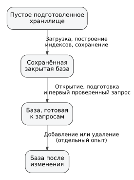

# Технические материалы к статье «Стоимость подготовки индексного состояния и чувствительность поиска к резидентности файлов в Polar.DB»

Отдельное [сопоставление публикации 2021 года, её исторического кода и версии ноября 2026 года](INDEX_EVOLUTION_CODE_AUDIT_2021_2026.md) содержит таблицу алгоритмов, прямые ссылки на строки обоих Git-срезов и ограничения сравнимости. Это **статический аудит**; отдельно выполнена [трёхпарная историческая серия](INDEX_EVOLUTION_DIRECT_RESULTS_20261108.md) с [12 исходными измерениями](../evidence/20261108-index-evolution/README.md).

Сопроводительные материалы к [основной рукописи](POLAR_DB_ARTICLE_DRAFT.md): определения, подробности методики, характеристики измерительной среды и данные более ранних экспериментальных серий. В приложении Д сохранены дополнительные результаты основной серии от 4 ноября 2026 года. Исторические результаты более ранних версий и независимых запусков выделены в приложениях В и Г и не смешиваются с новой серией.

<a id="glossary"></a>
# Словарь терминов и выражений

Словарь поясняет термины **в смысле, в котором они используются в этой статье**. Это не попытка дать исчерпывающие академические определения. Ссылки из основного текста ведут к соответствующим пунктам; близкие понятия внутри словаря также связаны между собой.

<a id="term-ab-experiment"></a>
**Сравнение вариантов (A/B-эксперимент)** — сравнение двух вариантов в максимально одинаковых условиях, когда меняется главным образом исследуемый фактор. Строгий A/B-опыт требует чередования сравниваемых вариантов в максимально одинаковой среде, а не сопоставления запусков, выполненных на разных версиях кода или в разные периоды.

<a id="term-asymptotic-complexity"></a>
**Асимптотическая сложность (asymptotic complexity)** — то, как растёт стоимость алгоритма при увеличении объёма входных данных, например близко к линейному или логарифмическому закону. Две точки — 50 тыс. и 5 млн записей — позволяют увидеть изменение времени, но недостаточны, чтобы надёжно установить такой закон.

<a id="term-btree"></a>
**B-дерево (B-tree)** — сбалансированная древовидная структура индекса, рассчитанная на эффективный поиск и работу с данными на внешней памяти. В SQLite индекс сохраняется в файле базы, поэтому его не требуется каждый раз целиком восстанавливать в оперативной памяти перед первым поиском.

<a id="term-byte-stream"></a>
**Байтовый поток** — последовательность байтов, в которую переводятся структурированные значения для хранения или передачи. См. также [сериализацию](#term-serialization).

<a id="term-persistence-boundary"></a>
**Граница фиксации (persistence boundary)** — момент эксперимента, после которого изменения не только внесены в рабочее состояние системы, но и выполнены предусмотренные стендом действия по их фиксации: например, завершение транзакции (commit), сброс буфера (`Flush`), перенос журнала (checkpoint) и запрос синхронизации файлов. Это операционное определение стенда, а не доказательство сохранности при внезапном отключении питания.

<a id="term-external-key"></a>
**Внешний ключ и внешний индекс (external key; external index / secondary index)** — в терминологии Polar.DB внешний ключ является индексируемым признаком записи, а внешний индекс — структурой для поиска по нему. Индекс неуникален: одному значению ключа могут соответствовать несколько записей. Здесь не имеется в виду ограничение ссылочной целостности SQL `FOREIGN KEY`.

<a id="term-file-representation"></a>
**Файловое представление (on-disk representation)** — совокупность файлов и служебных данных, которыми конкретный эксперимент представляет хранилище на диске. Его размер нельзя автоматически приравнивать к общему потреблению ресурсов, поскольку часть индекса Polar.DB находится в оперативной памяти.

<a id="term-file-cache"></a>
**Файловый кэш ОС (OS page cache)** — данные недавно прочитанных файлов, которые операционная система сохраняет в оперативной памяти. Если кэш специально не очищен, повторное чтение может обслуживаться из памяти, поэтому такой опыт нельзя называть физически «холодным» чтением SSD.

<a id="term-file-sync"></a>
**Синхронизация файлов (file synchronization)** — просьба к операционной системе передать накопленные изменения файлов нижележащему уровню хранения. Сам по себе такой вызов не гарантирует сохранность при отказе питания, если ниже существуют энергозависимые кэши.

<a id="term-flush"></a>
**Сброс накопленных изменений (flush)** — операция, заставляющая компонент передать накопленные изменения на следующий уровень хранения или обработки. Точный смысл зависит от реализации; в этой статье `Flush` является частью экспериментально заданной [границы фиксации](#term-persistence-boundary).

<a id="term-guid"></a>
**Глобально уникальный идентификатор (`Guid`)** — 128-битный идентификатор, исследуемый как один из типов ключа наряду с `int`, `long` и `string`. В исторической серии `linux-wsl2-ext4-20261010` использовалось прежнее представление Guid; в более поздних версиях, включая новую основную серию `20261104T075733840Z`, реализовано нативное 16-байтовое кодирование. Отдельная серия Guid оставлена как исторический контроль физического представления. Различия между сериями не позволяют изолировать эффект изменения физического формата.

<a id="term-checksum"></a>
**Контрольная сумма (checksum)** — компактное числовое значение, вычисляемое из набора возвращённых записей. Совпадение ожидаемой и фактической контрольной суммы вместе с числом строк используется как проверка того, что сравниваемые системы вернули одинаковый логический результат.

<a id="term-materialization"></a>
**Материализация результата (result materialization)** — фактическое чтение найденных записей и формирование из них результата запроса, а не только нахождение положения ключа в индексе. При выдаче тысяч или миллионов строк эта работа может стать основной частью времени запроса.

<a id="term-median"></a>
**Медиана** — центральное значение упорядоченного набора измерений: половина наблюдений не больше него, половина не меньше. Она менее чувствительна к отдельным выбросам, чем среднее арифметическое.

<a id="term-median-ratio"></a>
**Отношение медиан** — частное медиан двух сравниваемых систем, например `SQLite / Polar.DB`. Значение 2 означает, что в данном сценарии наблюдаемая медиана SQLite вдвое больше медианы Polar.DB; это описательный коэффициент, а не автоматически статистически значимое «ускорение».

<a id="term-managed-heap"></a>
**Управляемая куча (managed heap)** — область памяти .NET, в которой размещаются управляемые объекты и которой управляет сборщик мусора. Один снимок управляемой кучи не равен пиковому потреблению памяти процесса.

<a id="term-private-bytes"></a>
**Частная виртуальная память (private bytes)** — объём виртуальной памяти процесса, который не может совместно использоваться с другими процессами. Это диагностический показатель и не то же самое, что память, физически находящаяся в оперативной памяти (RAM).

<a id="term-working-set"></a>
**Резидентный набор страниц (working set)** — страницы памяти процесса, которые в данный момент находятся в физической памяти. Значение может меняться под управлением ОС и не является гарантированным пиком потребления.

<a id="term-nonunique-index"></a>
**Неуникальный индекс (non-unique index)** — индекс, в котором одному значению ключа разрешено соответствовать нескольким записям. В статье именно такой характер имеют исследуемые внешние индексы.

<a id="term-index-structure"></a>
**Индексное построение (index structure)** — структура данных над последовательностью, позволяющая находить записи по ключу быстрее, чем при полном последовательном просмотре. В этой статье «индексное построение» обозначает такую структуру независимо от конкретного алгоритма индексирования Polar.DB или SQLite.

<a id="term-index-state"></a>
**Индексное состояние (index state)** — данные и структуры, необходимые индексу для выполнения поиска в конкретный момент. Часть такого состояния Polar.DB после открытия подготавливается в оперативной памяти.

<a id="term-offset"></a>
**Файловое смещение (offset)** — позиция элемента внутри файлового или байтового представления, позволяющая перейти к нужной записи без последовательного обхода всех предшествующих данных.

<a id="term-logical-delete"></a>
**Логическое удаление (logical deletion)** — изменение логического состояния, при котором запись перестаёт считаться актуальной без обязательного немедленного физического удаления её старых байтов из файла.

<a id="term-logical-mutation"></a>
**Логическое изменение (logical update)** — изменение видимого пользователю состояния записи, которое может быть реализовано не перезаписью старого места, а добавлением нового физического состояния.

<a id="term-universal-sequence"></a>
**Универсальная последовательность (universal sequence)** — используемая в Polar.DB логическая надстройка над физической типизированной последовательностью. Она объединяет append-oriented хранение, первичный ключ и индексное состояние так, чтобы вставка, изменение и удаление выражались добавлением новых физических записей, а чтение возвращало только актуальное логическое состояние.

<a id="term-last-write-wins"></a>
**Правило последней записи (last-write-wins)** — правило разрешения нескольких физических версий одного первичного ключа: актуальной считается версия с наиболее поздним физическим смещением, если она не является маркером логического удаления (tombstone). Старые версии остаются в физической последовательности, но не входят в текущее логическое представление.

<a id="term-tombstone"></a>
**Маркер логического удаления (tombstone)** — специально помеченная новая версия первичного ключа, означающая логическое удаление. Она добавляется в конец так же, как обычное изменение, и делает предшествующую версию ключа невидимой без немедленного удаления её байтов из файла.

<a id="term-stale-offset"></a>
**Неактуальное файловое смещение (stale offset)** — физическое смещение старой версии записи, которая была заменена более поздней версией того же первичного ключа или закрыта маркером логического удаления. Список таких смещений позволяет после повторного открытия не принять старые записи статического снимка за актуальные.

<a id="term-persisted-format"></a>
**Формат сохраняемых данных (persisted format)** — договорённость о том, в каком порядке и виде байты данных, индексов и служебных структур записаны в файлы. Фраза «формат сохраняемых данных не изменён (persisted format unchanged)» означает, что новая реализация продолжает читать ранее созданное файловое представление без миграции самого формата.

<a id="term-recovery-metadata"></a>
**Метаданные восстановления (recovery metadata)** — небольшое сохранённое служебное состояние, помогающее восстановить актуальное индексное представление после повторного открытия. В текущем `USequence` сюда относятся, в частности, число записей и физическая граница сохранённого состояния, признак наличия сохранённого снимка первичного индекса (primary snapshot) и список неактуальных смещений (stale offsets). Если метаданных недостаточно или они не согласуются с файлами, реализация может перейти к более полному перестроению индекса.

<a id="term-open-only"></a>
**Открытие без подготовки к поиску (open-only)** — измеряемая операция «открыть и закрыть хранилище», не требующая подготовить его к индексному запросу. Она отделяет базовую стоимость открытия от подготовки индекса.

<a id="term-parameterized-query"></a>
**Параметризованный запрос (parameterized query)** — запрос, в котором значение ключа передаётся отдельным параметром, а не вставляется текстом в SQL. Это позволяет многократно использовать одну структуру команды с разными значениями.

<a id="term-primary-index"></a>
**Первичный индекс (primary index)** — индекс, используемый для поиска единственной логической записи по её [первичному ключу](#term-primary-key). В Polar.DB исследуемая статическая часть такого индекса включает ключевые/хеш-значения и смещения.

<a id="term-primary-key"></a>
**Первичный ключ (primary key)** — значение, однозначно идентифицирующее логическую запись. В эксперименте точечный поиск проверяется для ключей типов `int`, `long`, `Guid` и `string`.

<a id="term-pooling"></a>
**Пул соединений (connection pooling)** — повторное использование уже созданных физических соединений вместо полного открытия нового соединения. В эксперименте повторного открытия пул соединений SQLite (pooling) отключён, чтобы не принять повторное использование соединения за стоимость открытия.

<a id="term-prepared-query"></a>
**Подготовленный запрос (`Prepare`)** — команда, структуру которой провайдер подготавливает заранее для последующих выполнений с разными параметрами. Это уменьшает часть повторяющейся работы при серии однотипных запросов.

<a id="term-prepared-state"></a>
**Подготовленное состояние (warmed-up state)** — состояние хранилища после необходимых подготовительных действий и разогрева, когда измеряется собственно повторяющийся поиск, а не стоимость первого открытия или восстановления индексных структур.

<a id="term-provider"></a>
**Провайдер `Microsoft.Data.Sqlite`** — .NET-библиотека, через которую экспериментальная программа обращается к SQLite. Версия провайдера и версия самого ядра SQLite — разные характеристики среды.

<a id="term-pragmas"></a>
**Служебные команды SQLite (`PRAGMA`)** — специальные команды SQLite для чтения или изменения параметров работы базы. В стенде явно используется, в частности, `PRAGMA journal_mode=WAL`.

<a id="term-query-ready-reopen"></a>
**Полный цикл повторного открытия с подготовкой к запросу (query-ready reopen)** — повторно открыть хранилище, подготовить всё необходимое для индексного поиска, выполнить один проверенный точечный запрос и затем закрыть хранилище. Таймер включает закрытие, в отличие от изолированной задержки до первого ответа. Цикл противопоставляется [`open-only`](#term-open-only).

<a id="term-readytorun"></a>
**Предварительно скомпилированный код (`ReadyToRun`)** — механизм .NET, позволяющий поставлять сборки с заранее подготовленным машинным кодом для части методов, уменьшая объём JIT-компиляции во время запуска.

<a id="term-release-build"></a>
**Оптимизированная сборка (`Release`)** — сборка программы, предназначенная для обычного выполнения, в отличие от Debug-сборки с дополнительными возможностями отладки и потенциально иным профилем производительности.

<a id="term-reopen"></a>
**Повторное открытие (reopening)** — открытие ранее созданного и уже содержащего данные хранилища новым измеряемым сеансом. В статье оно разложено на [`open-only`](#term-open-only) и [`query-ready reopen`](#term-query-ready-reopen).

<a id="term-run-id"></a>
**Идентификатор запуска (run ID)** — уникальная метка конкретного экспериментального запуска, связывающая его результаты, манифест среды и первичные файлы измерений.

<a id="term-sequence"></a>
**Последовательность объектов (object sequence)** — базовая абстракция Polar.DB: упорядоченный набор типизированных элементов, отображаемый в байтовое представление и служащий основой для индексных построений.

<a id="term-serialization"></a>
**Сериализация (serialization)** — преобразование структурированного значения в последовательность байтов для хранения.

<a id="term-deserialization"></a>
**Десериализация (deserialization)** — обратное преобразование сохранённых байтов в структурированное значение.

<a id="term-server-gc"></a>
**Серверный режим сборщика мусора (Server GC)** — режим сборщика мусора .NET, ориентированный на серверные многопроцессорные нагрузки. В основной серии он зафиксирован как отключённый (`false`).

<a id="term-deterministic-data"></a>
**Детерминированные данные (deterministic data)** — данные, которые при одинаковых параметрах генерируются одинаковым образом. Это делает наборы ключей и ожидаемые результаты воспроизводимыми.

<a id="term-descriptive-statistics"></a>
**Описательная статистика (descriptive statistics)** — представление наблюдавшихся данных через медианы, диапазоны и другие сводные показатели без утверждения, что наблюдаемая разница статистически доказана для более широкой совокупности запусков.

<a id="term-tiered-compilation"></a>
**Многоуровневая компиляция (tiered compilation)** — механизм .NET, при котором код метода может сначала компилироваться быстрее, а затем перекомпилироваться с более сильной оптимизацией по мере выполнения.

<a id="term-tiered-pgo"></a>
**Многоуровневая профильно-управляемая оптимизация (tiered PGO)** — профиль-ориентированная оптимизация .NET, использующая сведения о фактическом выполнении программы для улучшения машинного кода горячих методов.

<a id="term-dynamic-tail"></a>
**Динамический хвост (dynamic tail)** — записи, добавленные после сохранённого статического снимка первичного индекса. При повторном открытии их необходимо воспроизвести (replay), чтобы актуальное состояние включало изменения после сохранённого снимка (snapshot).

<a id="term-ext4"></a>
**ext4** — распространённая файловая система Linux. В основной серии код бенчмарков и рабочие данные находились на виртуальном диске ext4 (virtual disk) внутри WSL2, а не в подключённом каталоге NTFS (bind mount).

<a id="term-live-memory-snapshot"></a>
**Снимок памяти открытого хранилища (live-memory snapshot)** — снимок управляемой, частной виртуальной и резидентной памяти (managed/private/working-set memory), сделанный до закрытия построенного или готового к запросам хранилища. Он показывает живое состояние в конкретный момент, но не гарантированное пиковое потребление памяти (peak memory).

<a id="term-transient-managed-allocation"></a>
**Временные выделения управляемой памяти (transient managed allocations)** — суммарный объём управляемых выделений за измеряемую стадию, включая объекты, которые затем могут быть освобождены сборщиком мусора (garbage collector, GC). Этот показатель отличается от удерживаемой памяти и снимка памяти открытого хранилища (retained/live memory) после завершения стадии.

<a id="term-wsl2"></a>
**WSL2** — Windows Subsystem for Linux 2: Linux-среда, работающая через виртуализированное Linux-ядро под Windows. Результат WSL2 нельзя автоматически приравнивать к измерениям непосредственно в Linux на физическом оборудовании (native/bare-metal Linux).

<a id="term-wal"></a>
**Упреждающая журнализация (write-ahead logging, WAL)** — режим SQLite, в котором изменения сначала записываются в отдельный журнал, а затем переносятся в основной файл базы. В стенде он включается командой [`PRAGMA`](#term-pragmas) `journal_mode=WAL`.

<a id="term-checkpoint"></a>
**Контрольная точка журнала WAL (WAL checkpoint)** — перенос накопленных изменений из WAL-журнала в основной файл SQLite. В пакетном опыте изменений перенос журнала (checkpoint) входит в измеряемую [границу фиксации](#term-persistence-boundary).

<a id="app-a"></a>
# Приложение А. Детали методики основной серии

<a id="app-a-1"></a>
## А.1. Принцип сравнения

Стенд сравнивает одинаковый внешний результат операции, а не идентичное внутреннее устройство систем. Измерения разделяют жизненный цикл на загрузку (`Load`), построение индексов (`Build`), открытие, подготовку к индексным запросам (query-ready), поиск (lookup), обход (traversal), изменения без фиксации (volatile mutation) и операции с границей сохранения (durable boundary). Это необходимо, чтобы дорогая подготовительная стадия не скрывалась за средним временем продолжительного сеанса, а низкая задержка разогретого поиска (hot lookup latency) не распространялась на короткоживущие процессы.

<a id="app-a-2"></a>
## А.2. Структура запуска и артефакты

Координатор фиксирует идентификатор запуска (run ID) и параметры среды, запускает рабочие процессы SQLite и Polar.DB раздельно, сверяет версию исходного кода (commit) и конфигурацию оптимизированной сборки (Release), затем сохраняет исходные JSON/CSV, манифест условий (manifest) и HTML-отчёт. Первичными материалами анализа служат исходные JSON/CSV и манифест; HTML является производным отчётом. Скрипты `run-independent-series.py` и `analyze-independent-series.py` подготовлены для будущих независимых повторений с контрбалансировкой порядка систем (ABBA); **в основной серии 4 ноября они не применялись**. Исторические исходные данные не пересчитываются как фиктивные независимые наблюдения.

Схема переходов описывает модель протокола: она не является результатом отдельного сквозного измерения.



<p align="center">Рисунок А.1 — Логические состояния хранилища и границы экспериментальных переходов</p>

<a id="app-a-3"></a>
## А.3. Поиск по первичному ключу (primary-key lookup)

Для ключей `int`, `long`, `Guid` и `string` используются две фазы. В первой не выполняется специальный разогрев поиска (lookup warm-up); во второй предусмотрены разогрев файлов и пробные поисковые запросы. В опыте на 5 млн записей исходный JSON содержит 30 пакетных наблюдений средних времён (batch-average samples) в первой фазе и 100 во второй, а также 2000 измерений задержки отдельных запросов (latency samples) на фазу. В таблицах приведены медианы пакетных средних и медиана/95-й процентиль задержек (median/p95 latency).

<a id="app-a-4"></a>
## А.4. Поиск по внешнему индексу: обычный и высокочастотный ключ (high-frequency lookup)

Для обычного внешнего индекса размер пакета (batch) подбирается приблизительно на 20 тыс. возвращаемых строк: при 50 тыс. исходных записей один запрос возвращает около 50 строк, при 5 млн — около 5000. Выполняются 15 измеряемых пакетов без специального разогрева и 30 в подготовленной фазе, а также 100 измерений задержки отдельных запросов.

Высокочастотному ключу (high-frequency key) соответствует 40% массива. Для 5 млн записей один запрос материализует 2 млн строк. В каждом пакете выполняется один запрос; на фазу приходятся по пять пакетов и пять измерений задержки.

<a id="app-a-5"></a>
## А.5. Построение первичного и внешних индексов (primary and secondary index build)

`BuildPrimaryIntOnly` использует первичное хранилище фиксированных 32-битных целых (fixed Int32 primary storage): три разогревочных и 15 измеряемых повторов. Времена `Load`, `Build` и `Flush` фиксируются раздельно; для `Load`/`Build` дополнительно записываются выделенные байты (allocated bytes) и прирост числа сборок мусора (GC deltas).

`BuildExternalIndexesOnly` строит четыре типизированных внешних индекса (typed secondary indexes) над предварительно подготовленным первичным хранилищем: два разогревочных и десять измеряемых повторов. Сценарий выполнен только для 50 тыс. и 5 млн записей.

<a id="app-a-6"></a>
## А.6. Обход и восстановление динамического хвоста (traversal and dynamic-tail replay)

`TraversalOnly` выполняет полный логический обход (logical traversal) подготовленного хранилища: два разогревочных и десять измеряемых повторов. `ReopenWithTail` использует хранилище с фиксированным 32-битным представлением и 10 000 дописанных записей после сохранённого статического снимка (persisted snapshot). Фиксированная длина записей исключает смешение восстановления динамического хвоста (tail replay) со сканированием записей переменной длины при восстановлении (variable-record recovery scan).

<a id="app-a-7"></a>
## А.7. Добавление, удаление и граница фиксации (append/delete; durability boundary)

Для изменений без фиксации (volatile mutation) используются 200 разогревочных и 2000 измеряемых операций. В исторической основной серии SQLite обслуживал дополнительные уникальные индексы; серия `20261104T075733840Z` уже выполнена с исправленным сопоставимым логическим профилем индексов. Вариант с заданной границей фиксации (durable variant) измеряет 15 пакетов по 100 операций после двух разогревочных пакетов. Для SQLite измеряемый пакет включает завершение транзакции (commit), контрольную точку WAL (checkpoint) и синхронизацию файлов (file sync); для Polar.DB — `Flush` и синхронизацию файлов. В статье время пакета делится на 100. Этот протокол сам по себе не доказывает одинаковой стойкости к аварийному отключению питания.

<a id="app-a-8"></a>
## А.8. Повторное открытие (`ReopenOnly`)

Перед измеряемым повторным открытием очищается пул соединений SQLite (connection pool), а новые подключения используют `Pooling=False`. В исторической основной серии выполнялись пять разогревочных и 30 измеряемых повторов. Показатель `open-only` включал **создание и закрытие всех объектов хранилища**, а не только открытие файловых дескрипторов. Сценарий готовности к запросам (query-ready) дополнительно включал подготовку индексов и один проверяемый поиск по первичному ключу. После повторов один готовый к запросам экземпляр оставался открытым для снимка ресурсов (resource snapshot).

В обновлённом протоколе `ReopenOnly` отдельно измеряется открытие только файловых дескрипторов без разбора схемы и индексов. В каждом повторе показатели создания/закрытия объектов (constructor-open-only) и готовности к запросам (query-ready) получают связанные временные отметки. У Polar.DB выделены создание последовательности и первичного индекса, создание внешних индексов, чтение метаданных, контрольная точка (checkpoint), восстановление первичного и внешних индексов, воспроизведение динамического хвоста либо резервное перестроение (fallback rebuild), первый запрос и закрытие. У SQLite отдельно фиксируются создание соединения, `Open`, проверенный первый запрос и `Dispose`. Измерения стадий сохраняются в исходных JSON/CSV и таблице HTML. Медианы стадий нельзя складывать как медиану полного времени; открытие только файлов не входит в показатель constructor-open-only. Подробности приведены в `REOPEN_STAGE_DECOMPOSITION.md`; старые результаты на 5 млн записей не пересчитывались.

<a id="app-a-9"></a>
## А.9. Эталон корректности (correctness oracle)

Для сценариев жизненного цикла заранее вычисляются ожидаемые количество строк и контрольная сумма (rows/checksum). Для поиска эталон отдельно рассчитывается для ключей пакетных запросов и выборки индивидуальных задержек (batch keys и latency keys). В основной серии эталон вычислялся одним проходом по исходным данным только для реально запрошенных ключей, вне измеряемого времени (measured interval). Отчёты 19 сценариев показывали совпадение контрольных значений, но этот факт не означает самостоятельной проверки построенного индекса в каждом сценарии; ограничения указаны в разделе 3.5.

<a id="app-a-10"></a>
## А.10. Память и сборка мусора (garbage collection, GC)

Для стадий `Load` и `Build` фиксируется разность `GC.GetTotalAllocatedBytes` и прирост числа сборок мусора поколений Gen0/Gen1/Gen2. Снимок ресурсов открытого хранилища (live resource snapshot) включает управляемую память (managed bytes), частную виртуальную память (private bytes) и резидентный набор страниц (working set). Эти показатели описывают разные свойства потребления ресурсов и не взаимозаменяемы.

<a id="app-a-11"></a>
## А.11. Очистка рабочих данных

Рабочие данные бенчмарка (benchmark data) удаляются после завершения случая измерения и запуска (case/run), чтобы серия помещалась на доступном накопителе. Очистка выполняется как инфраструктурная операция и не считается оптимизацией Polar.DB либо частью измеряемой задержки (latency).

---

<a id="app-b"></a>
# Приложение Б. Технические сведения основной серии

<a id="app-b-1"></a>
## Б.1. Идентичность серии

- основная серия: 4 ноября 2026 года, run ID `20261104T075733840Z`;
- исходный SHA: `abbb03cdc34cff1c11e7550494f65b03dad9afd1`;
- все 19 манифестов: `publicationReady=true`, `gitDirty=false`, оптимизированная сборка Release;
- нативное ядро SQLite: версия 3.53.3; `Microsoft.Data.Sqlite`: 9.0.4.

<a id="app-b-2"></a>
## Б.2. Среда

Linux / WSL2, файловая система ext4, Ubuntu 24.04.4 LTS, процессор Intel Core i5-12400 (12 логических процессоров), SDK 10.0.400, .NET Runtime 10.0.11, `Server GC=false`. Условия фиксируются в манифестах исходной серии; результаты не переносятся автоматически на другие машины и версии.

<a id="app-b-3"></a>
## Б.3. Размеры сценариев

Все 19 сценариев измерены на 50 000 и 5 000 000 записей, включая `BuildExternalIndexesOnly`. Основная серия имеет 220 успешных проверок количества строк и контрольных сумм.

<a id="app-b-4"></a>
## Б.4. Расположение результатов

Оригинальный [исходный архив](../evidence/20261104/20261104T075733840Z-abbb03c-ext4.tar.gz) основной серии с CSV/JSON, 19 манифестами, `validation.json` и журналами опубликован отдельно от [снимка Stage 4B](../evidence/20261107/README.md). SHA-256: `0177fc09f46a44e546330e576c8be22dbb04cf008a11ee5ed30725a4c3036b87` ([SHA-256](../evidence/20261104/SHA256SUMS)); порядок проверки приведён в [README серии](../evidence/20261104/README.md). Пересчёт из исходных файлов подтвердил 160/160 числовых показателей таблиц 1–9 в пределах округления; все 19 хешей `.raw.json` из `validation.json` совпали. В архивном `SOURCE.txt` стоит `source-worktree: dirty`, но все 19 манифестов координаторов и 38 манифестов рабочих процессов фиксируют `gitDirty=false` и `abbb03cdc34cff1c11e7550494f65b03dad9afd1` на момент измерений. Причина различия при упаковке не установлена; утверждать изменение исходного кода во время измерений на его основании нельзя. Дополнительный малый эксперимент от 5 ноября задокументирован отдельно в [`REOPEN_DIAGNOSTIC_20261105.md`](REOPEN_DIAGNOSTIC_20261105.md).

---

<a id="app-c"></a>
# Приложение В. Предыдущие экспериментальные серии

<a id="app-c-1"></a>
## В.1. Назначение и идентичность предыдущих серий

Основной текст статьи опирается на серию `linux-wsl2-ext4-20261010` и фиксацию исходного кода (commit) `20492b297f3638f19230e4a3f3acfe6927951869`. Ниже сохранены результаты двух предшествующих серий как самостоятельные экспериментальные срезы соответствующих версий Polar.DB:

- предыдущая основная серия `20260810T030729570Z`, commit `e093da0247ec58c7fb78fc381eca52fa002b0967`;
- серия повторного открытия (reopen) `20260811T060237246Z-eed96558-reopen-only`, commit `eed965582a1f0b1e6d0796c09528f0b7876b1ba4`.

Они выполнены в Windows/NTFS-среде и **не смешиваются** с числами современных серий настоящей статьи. Поскольку между сериями одновременно менялись код и среда, приложение не используется для вывода о различии Windows и Linux. Его задача — сохранить воспроизводимую историю ранее измеренных состояний библиотеки и показать, какие свойства профиля наблюдались до текущей реализации.

<a id="app-c-2"></a>
## В.2. Построение целочисленного первичного индекса

Эксперимент выделяет построение индекса по `id` и последующий [`flush`](#term-flush). Загрузка исходных значений в основную измеряемую величину не входит. Выполняются три разогревающих и десять измеряемых построений.

| Число записей | Polar.DB, мс | SQLite, мс | SQLite / Polar.DB |
|---:|---:|---:|---:|
| 50 000 | **9,800** | 16,614 | 1,70 |
| 5 000 000 | **186,797** | 1488,885 | 7,97 |

Для 5 млн записей размер файлового представления данного опыта составил примерно 100,0 MB у Polar.DB и 118,6 MB у SQLite. Полученный коэффициент относится только к изолированной операции построения данного первичного индекса и не характеризует полную загрузку произвольной базы данных.

<a id="app-c-3"></a>
## В.3. Поиск по первичному ключу

Для каждого типа ключа рассматриваются поиск после повторного открытия без специального разогрева и поиск в подготовленном состоянии. Термин «без разогрева» не означает принудительного очищения системного файлового кэша Windows.

Медиана среднего времени одного запроса внутри измеряемого пакета в подготовленном состоянии:

| Тип ключа | Polar.DB, 50 тыс. | SQLite, 50 тыс. | Polar.DB, 5 млн | SQLite, 5 млн | SQLite / Polar.DB на 5 млн |
|---|---:|---:|---:|---:|---:|
| `int` | **0,00560** | 0,00601 | **0,00406** | 0,00794 | 1,95 |
| `long` | **0,00544** | 0,00724 | **0,00392** | 0,00847 | 2,16 |
| `Guid` | **0,00556** | 0,00691 | **0,00381** | 0,01416 | 3,72 |
| `string` | **0,00626** | 0,01175 | **0,00458** | 0,00755 | 1,65 |

Для всех четырёх типов в этом запуске медиана Polar.DB была ниже. На массиве 50 тыс. различие для `int` невелико, тогда как на 5 млн отношение медиан SQLite / Polar.DB больше. С учётом микросекундного масштаба и отсутствия независимых серий это наблюдение не используется для вывода об асимптотике или статистической значимости различий.

В опыте первичного поиска по `int` [файловое представление](#term-file-representation) составило около 5,75 MB против 14,57 MB на 50 тыс. записей и 575,0 MB против 1688,6 MB на 5 млн записей для Polar.DB и SQLite соответственно. Это не является оценкой полного потребления памяти: часть первичного индекса Polar.DB находится в оперативной памяти.

<a id="app-c-4"></a>
## В.4. Поиск по обычному внешнему ключу

Одному значению обычного внешнего ключа соответствует приблизительно 1/1000 массива: около 50 элементов результата на 50 тыс. записей и около 5000 на 5 млн.

| Тип ключа | Polar.DB, 50 тыс. | SQLite, 50 тыс. | Polar.DB, 5 млн | SQLite, 5 млн |
|---|---:|---:|---:|---:|
| `int` | 0,195 | **0,090** | 24,562 | **22,083** |
| `long` | 0,198 | **0,093** | 23,865 | **22,176** |
| `Guid` | 0,202 | **0,096** | 24,202 | **24,144** |
| `string` | 0,205 | **0,105** | 27,085 | **22,392** |

На 50 тыс. записей SQLite приблизительно вдвое быстрее Polar.DB для данного типа выборки. При 5 млн различие уменьшается: для `Guid` результаты практически совпадают, для остальных типов SQLite быстрее примерно на 8–21%.

Следовательно, выигрыш при нахождении единственной записи по первичному ключу не переносится автоматически на неуникальное индексное построение. При росте числа найденных записей существенную роль играют получение смещений, проверка актуальности и формирование результата.

<a id="app-c-5"></a>
## В.5. Поиск по высокочастотному внешнему ключу

В этом варианте одному внешнему ключу соответствует 40% исходных элементов: 20 тыс. на малом массиве и 2 млн на большом.

| Тип ключа | Polar.DB, 50 тыс. | SQLite, 50 тыс. | Polar.DB, 5 млн | SQLite, 5 млн |
|---|---:|---:|---:|---:|
| `int` | 75,761 | **35,614** | 5408,341 | **3654,167** |
| `long` | 84,379 | **37,263** | 5562,963 | **3580,304** |
| `Guid` | 88,425 | **36,288** | 5323,905 | **3720,585** |
| `string` | 76,033 | **37,439** | 5499,012 | **3643,057** |

При 5 млн записей SQLite быстрее примерно в 1,43–1,55 раза. В таком режиме нахождение диапазона индекса составляет только часть общей работы; требуется получить и обработать два миллиона записей.

<a id="app-c-6"></a>
## В.6. Добавление и логическое удаление

Для изменения данных используются две характеристики. Первая — время изменения **до границы фиксации**. Вторая — время изменения **с фиксацией**, то есть среднее время одной операции в пакете из 100 изменений, включающем commit/`Flush` и запрос синхронизации файлов средствами операционной системы.

| Операция | Polar.DB, 50 тыс. | SQLite, 50 тыс. | Polar.DB, 5 млн | SQLite, 5 млн |
|---|---:|---:|---:|---:|
| добавление до фиксации | **0,0021** | 0,0319 | **0,0006** | 0,1108 |
| добавление с фиксацией | 0,300 | **0,203** | **0,310** | 0,678 |
| удаление до фиксации | **0,0018** | 0,0213 | **0,0005** | 0,0408 |
| удаление с фиксацией | 0,289 | **0,192** | **0,276** | 0,354 |

До фиксации Polar.DB показал меньшее измеренное время на обоих размерах. Однако абсолютные значения порядка 0,5–2,1 мкс находятся в диапазоне, где накладные расходы микробенчмарка могут составлять заметную долю результата. Поэтому эти значения используются как качественная характеристика рабочего пути и не служат основанием для заявлений о кратном преимуществе. Количественное сравнение операций с фиксацией опирается на пакетные измерения.

Результат с фиксацией зависит от размера исходного массива. На 50 тыс. записей SQLite быстрее; на 5 млн Polar.DB быстрее примерно в 2,19 раза для добавления и в 1,28 раза для удаления.

Таким образом, время изменения рабочего состояния до фиксации не характеризует операцию с включённой в протокол границей фиксации. Кроме того, запрос синхронизации средствами ОС сам по себе не является доказательством сохранности данных при отказе питания и наличии энергозависимых кэшей устройства.

<a id="app-c-7"></a>
## В.7. Повторное открытие и подготовка индексного состояния

Эксперимент повторного открытия выполнен серией:

`20260811T060237246Z-eed96558-reopen-only`

при следующей фиксации исходного кода (commit):

`eed965582a1f0b1e6d0796c09528f0b7876b1ba4`.

Повторное открытие SQLite измеряется без использования пула соединений; перед началом измерений пул соединений очищается. Манифест фиксирует версию ядра SQLite `3.53.3`, внутренний флаг стенда `publicationReady = true`, чистое рабочее дерево и Release-сборку. Выполняются 5 разогревающих и 30 измеряемых повторов для каждого размера.

Измеряются две стадии:

1. **только открытие** ([`open-only`](#term-open-only)) — открыть и закрыть хранилище без требования выполнить индексный запрос;
2. **открытие с подготовкой к поиску** ([`query-ready reopen`](#term-query-ready-reopen)) — открыть, подготовить метаданные и индексное состояние и выполнить один индексированный поиск по первичному ключу.

Медианы:

| Число записей | SQLite: только открытие | Polar.DB: только открытие | SQLite: с поиском | Polar.DB: с поиском |
|---:|---:|---:|---:|---:|
| 50 000 | **0,08370** | 1,36820 | **0,82720** | 15,67085 |
| 5 000 000 | **0,12035** | 1,16225 | **0,81565** | 775,71060 |

Для 50 тыс. записей отношение медиан операции «открытие с подготовкой и одним поиском» составляет примерно 18,9 в пользу SQLite. При 5 млн разрыв существенно увеличивается. Точный коэффициент для большого массива не рассматривается как самостоятельный результат: он относится к конкретному определению опыта, одной машине и текущему состоянию файлового кэша Windows, который специально не очищается.

Содержательно важнее наблюдаемый характер изменения времени между двумя размерами массива. Для SQLite открытие без использования пула соединений и один точечный запрос в этом опыте остаются около 1 мс при увеличении массива с 50 тыс. до 5 млн; это согласуется с тем, что индекс [Б-дерево (B-tree)](#term-btree) хранится в файле базы данных, однако сам эксперимент не выделяет причинный вклад отдельных внутренних механизмов SQLite. В Polar.DB измеряемая операция включает подготовку размещаемого в оперативной памяти состояния первичного индекса и возрастает приблизительно с 15,7 до 775,7 мс.

Медиана `open-only` Polar.DB остаётся около 1–1,4 мс и практически не зависит от размера массива. Следовательно, основная добавочная стоимость связана не с базовой операцией открытия хранилища, а с подготовкой индексного состояния.

Этот результат непосредственно дополняет результат раздела 6.2: малое время точечного поиска Polar.DB достигается в уже подготовленном состоянии, подготовка которого при 5 млн записей является отдельной заметной операцией. Для длительно живущего хранилища эта стоимость может амортизироваться множеством запросов; для частого открытия короткоживущих экземпляров она может доминировать.

<a id="app-c-8"></a>
## В.8. Изменение после размещения смещений первичного индекса в памяти

Предыдущая серия `20260808T095444545Z` была выполнена на commit `3f8476f34b72b1ec18f875b3ac35143a00adac42`. Между ней и основной серией в исследуемом пути первичного индекса было добавлено хранение статических смещений в оперативной памяти рядом с массивом ключевых или хеш-значений.

Для 5 млн записей время поиска в подготовленном состоянии изменилось следующим образом:

| Тип ключа | До, мкс/запрос | После, мкс/запрос | Изменение |
|---|---:|---:|---:|
| `int` | 5,284 | **4,065** | −23,1% |
| `long` | 5,488 | **3,921** | −28,6% |
| `Guid` | 5,862 | **3,811** | −35,0% |
| `string` | 10,049 | **4,585** | −54,4% |

В двух сопоставляемых исторических сериях собственное время Polar.DB для открытия с подготовкой к поиску изменилось приблизительно с 564,5 до 701,7 мс; в отдельной серии повторного открытия получено 775,7 мс. Эти прогоны выполнялись в разное время, поэтому различия между ними являются сравнением версий и запусков, а не строгим чередующимся [A/B-экспериментом](#term-ab-experiment). Проценты снижения измеренного времени поиска не следует интерпретировать как точный причинный эффект одной программной оптимизации без специального чередующегося A/B-опыта.

<a id="app-c-9"></a>
## В.9. Обсуждение предыдущих результатов

Полученные данные позволяют выделить несколько наблюдений.

Во-первых, специализированное первичное индексное построение Polar.DB хорошо соответствует точечному поиску. На 5 млн записей меньшее измеренное время относительно выбранной реализации SQLite наблюдалось для всех четырёх типов первичного ключа.

Во-вторых, результаты внешнего индекса показывают другую картину. При выдаче множества записей SQLite не уступает, а чаще превосходит текущую реализацию Polar.DB. Чем больше результат, тем в большей степени измерение характеризует обход и формирование записей, а не собственно нахождение ключа.

В-третьих, для операций изменения принципиально наличие границы фиксации. Очень малое время изменения до фиксации является характеристикой рабочего пути, основанного на добавлении нового состояния, но не характеризует операцию с включённой границей фиксации. После включения пакетной фиксации разница уменьшается и на малом массиве меняет знак.

В-четвёртых, результаты по двум размерам данных показывают необходимость исследовать масштабирование. Построение первичного индекса Polar.DB относительно SQLite различается примерно в 1,7 раза на 50 тыс. и почти в 8 раз на 5 млн. Для фиксируемых изменений преимущество Polar.DB появляется только на большом исходном массиве.

В-пятых, файловое представление Polar.DB в исследованных основных сценариях существенно меньше. Однако этот результат необходимо рассматривать вместе с использованием оперативной памяти для индексных массивов и с различием внутренних форматов хранения двух систем. Малый размер файлов не означает автоматически меньшего полного потребления ресурсов.

Наконец, опыт повторного открытия выявляет существенный архитектурный компромисс. В подготовленном состоянии Polar.DB быстрее SQLite при точечном поиске по первичному ключу, но подготовка этого состояния после открытия масштабируется с объёмом первичного индекса. На 5 млн записей повторное открытие SQLite без использования пула соединений с точечным запросом занимает медианно около 0,82 мс, тогда как Polar.DB — около 776 мс. При этом медиана `open-only` Polar.DB составляет около 1,16 мс.

Таким образом, эксперимент не даёт основания для общей формулировки «Polar.DB быстрее SQLite» или обратной ей. Системы имеют различный профиль характеристик. Polar.DB показывает меньшее время на исследованном первичном индексном построении и точечном поиске в подготовленном состоянии, но уступает в массовой выборке по неуникальному индексу и существенно дороже подготавливает первичный индекс после открытия.

<a id="app-c-10"></a>
## В.10. Технические сведения предыдущих серий

<a id="app-c-10-1"></a>
### В.10.1. Предыдущая основная серия

- идентификатор серии (series ID): `20260810T030729570Z`;
- commit: `e093da0247ec58c7fb78fc381eca52fa002b0967`;
- рабочее дерево Git (working tree): без изменений;
- Release;
- `.NET 10.0.7`, x64;
- версия сборки Polar.DB `2.1.3.0`;
- версия сборки `Microsoft.Data.Sqlite` `9.0.4.0`;
- Server GC: `false`.

<a id="app-c-10-2"></a>
### В.10.2. Серия повторного открытия

- идентификатор серии (series ID): `20260811T060237246Z-eed96558-reopen-only`;
- commit: `eed965582a1f0b1e6d0796c09528f0b7876b1ba4`;
- рабочее дерево Git (working tree): без изменений;
- Release;
- внутренний флаг `publicationReady = true` у координатора и обоих рабочих процессов;
- `.NET 10.0.7`, x64;
- SDK `10.0.203`;
- версия сборки Polar.DB `2.1.3.0`;
- версия сборки `Microsoft.Data.Sqlite` `9.0.4.0`;
- версия ядра SQLite `3.53.3`;
- порядок запуска: Polar.DB → SQLite;
- измеряемые открытия SQLite выполняются без использования пула соединений;
- перед началом измерений пул соединений SQLite очищается.

<a id="app-c-10-3"></a>
### В.10.3. Операционная система и процессор

- Microsoft Windows 11 Pro, номер сборки (build) `26200`;
- Intel Core i5-12400;
- 6 физических ядер;
- 12 логических процессоров;
- кэш L2 по данным WMI (L2 cache): 7680 KiB;
- кэш L3 по данным WMI (L3 cache): 18432 KiB.

<a id="app-c-10-4"></a>
### В.10.4. Оперативная память

- 31,78 GiB видимой физической памяти;
- 4 × 8 GiB;
- настроенная скорость памяти (configured clock speed): 3200 MT/s;
- две планки Patriot Memory `4400 C19 Series`;
- две планки Gloway `TAC4U3200E16081C`.

Конфигурация смешанная; значения WMI поля `Speed` различаются, поэтому в выводах не предполагается одинаковый SPD-профиль всех модулей.

<a id="app-c-10-5"></a>
### В.10.5. Накопитель

- Samsung SSD 980 PRO 250GB;
- SSD, NVMe;
- GPT;
- рабочий том `D:` — NTFS.

<a id="app-c-10-6"></a>
### В.10.6. `global.json`

Для фиксации исходного кода (commit) предыдущей основной серии использовалась конфигурация:

```json
{
  "sdk": {
    "version": "10.0.0",
    "rollForward": "latestMajor",
    "allowPrerelease": true
  }
}
```

Эта конфигурация не обеспечивала строгой фиксации конкретного SDK. Для серии повторного открытия использован SDK `10.0.203` с `rollForward = latestPatch`. Поэтому для предыдущей основной серии зафиксирована среда выполнения, но не конкретный SDK, а серия повторного открытия имеет явно заданную SDK-конфигурацию.

<a id="app-c-11"></a>
## В.11. Особенности исторического протокола

Предыдущая основная серия использовала 16 исполняемых программ (executables) и массивы из 50 тыс. и 5 млн записей. Для исторического сценария `BuildPrimaryIntOnly` выполнялись три разогревочных и десять измеряемых повторов (warm-up/measured repetitions). Повторное открытие (reopen) позднее исследовалось отдельной серией из пяти разогревочных и 30 измеряемых повторов с предварительной очисткой пула соединений SQLite (connection pool) и параметром `Pooling=False` для измеряемых подключений.

Эти различия протокола являются ещё одной причиной не объединять исторические и текущие выборки в одну статистическую совокупность. Исторические таблицы следует читать как результаты соответствующих идентификаторов запусков (run IDs) и версий исходного кода (commits), а не как дополнительные наблюдения (samples) основной серии `linux-wsl2-ext4-20261010`.

---

<a id="historic-guid-series"></a>
# Приложение Г. Исторические результаты отдельной серии Guid

## Г.1. Методика исторической серии Guid
Дополнительная серия посвящена реализации Polar.DB с нативным 16-байтовым представлением Guid. Исследовались точечный поиск по первичному ключу, выборка по неуникальному внешнему ключу и массовая выборка при высокой частоте одного значения. Сравнение с SQLite выполнено на детерминированных наборах из 50 тыс. и 5 млн записей. Реализации исполнялись в раздельных процессах при одинаковой постановке запросов; перед анализом время измерялось только после проверки логической эквивалентности результатов.

Эксперименты проводились в виртуализированной среде Ubuntu 24.04.5 LTS, с четырьмя доступными логическими процессорами и .NET 10.0.13, в оптимизированной конфигурации Release. Наборы разного размера исследовались на отдельных вычислительных узлах, поэтому совпадение их физической конфигурации и фоновой нагрузки не гарантируется. Сравнения Polar.DB и SQLite внутри одного сценария получены в рамках одной вычислительной среды; межмасштабные сравнения характеризуют разные экспериментальные условия.

Для первичного поиска использовались 30 пакетов запросов без специального разогрева и 100 пакетов в подготовленной фазе, по 100 запросов в пакете. Для обычного внешнего поиска — соответственно 15 и 30 пакетов; каждый запрос возвращал примерно 50 записей в массиве из 50 тыс. или 5000 в массиве из 5 млн. В сценарии высокой частоты одному внешнему ключу соответствовало 40% записей (20 тыс. или 2 млн результатов); в каждой фазе измерялось по пять отдельных запросов. Основной показатель — медиана средних времён запроса внутри измеряемого пакета, а не 95-й процентиль распределения индивидуальных запросов. Фаза без разогрева не предполагает принудительной очистки файлового кэша операционной системы.

В отдельной исторической серии для оценки затрат физического представления Guid сравнивались два способа хранения в UniversalSequenceBase: бинарный 16-байтовый и строковый 33-байтовый (32 символа с префиксом длины). На массивах из 50 тыс. и 1 млн значений выполнено семь повторов с чередованием порядка кодировок. Первый повтор исключён из расчёта медианы по заранее заданному протоколу, поэтому статистики относятся к оставшимся шести повторам. Время записи включает формирование представления, работу с потоком и завершение записи; время чтения — повторное открытие, последовательное чтение, восстановление Guid и проверку значений.

Новая основная серия и исторический микробенчмарк кодирования Guid выполнены на различных версиях и вычислительных узлах. Сравнивать их как парный опыт изменения формата Guid нельзя.


## Г.2. Результаты исторической серии Guid

В таблице Г.1 приведён поиск по Guid после предварительного разогрева файлов и пути запроса. Для поиска по первичному ключу (primary) время указано в **мкс/запрос**, для внешнего поиска (external) — в **мс/запрос**. Значения времени между разными категориями запросов нельзя сравнивать без учёта объёма возвращаемых данных. Отношение `SQLite / Polar.DB` больше единицы означает меньшую наблюдаемую медиану у Polar.DB.

Таблица Г.1 — Поиск по Guid в дополнительной серии после разогрева

| Сценарий | Исходных записей | Результат запроса | Единица | Polar.DB | SQLite | SQLite / Polar.DB |
|---|---:|---:|---|---:|---:|---:|
| Primary Guid | 50 000 | 1 запись | мкс | **4,481** | 15,161 | 3,38 |
| Primary Guid | 5 000 000 | 1 запись | мкс | **4,952** | 13,450 | 2,72 |
| External Guid, обычный | 50 000 | ≈50 записей | мс | 0,125225 | **0,111451** | 0,89 |
| External Guid, обычный | 5 000 000 | ≈5000 записей | мс | **14,178575** | 18,234225 | 1,29 |
| External Guid, 40% совпадений | 50 000 | 20 000 записей | мс | 61,466 | **32,004** | 0,52 |
| External Guid, 40% совпадений | 5 000 000 | 2 000 000 записей | мс | **3874,455** | 4893,380 | 1,26 |

В таблице Г.2 приведены те же сценарии без предварительного разогрева запросов. Это не измерение доступа к физически холодному накопителю: системный файловый кэш принудительно не очищался.

Таблица Г.2 — Поиск по Guid в дополнительной серии без специального разогрева

| Сценарий | Исходных записей | Единица | Polar.DB | SQLite | SQLite / Polar.DB |
|---|---:|---|---:|---:|---:|
| Primary Guid | 50 000 | мкс | **6,311** | 14,965 | 2,37 |
| Primary Guid | 5 000 000 | мкс | **5,160** | 12,125 | 2,35 |
| External Guid, обычный | 50 000 | мс | 0,206493 | **0,192400** | 0,93 |
| External Guid, обычный | 5 000 000 | мс | **14,841800** | 18,799650 | 1,27 |
| External Guid, 40% совпадений | 50 000 | мс | 57,184 | **41,271** | 0,72 |
| External Guid, 40% совпадений | 5 000 000 | мс | **3910,444** | 4845,210 | 1,24 |

Значения в обеих таблицах получены из исходных выборок соответствующих фаз эксперимента. Коэффициенты последнего столбца — **отношения медиан двух систем**, а не медианы отношений отдельных измерений. В подготовленной фазе использованы 100 пакетов для первичного поиска, 30 — для обычного внешнего и пять — для высокочастотного. Достоверность наблюдаемых различий между независимыми экспериментальными сериями статистически не оценивалась.

В данной серии поиск по первичному ключу типа Guid (primary Guid lookup) имеет меньшие наблюдаемые медианы у Polar.DB для обоих размеров данных. Для двух сценариев внешнего поиска (external lookup) на 50 тыс. записей меньшие медианы у SQLite, на 5 млн — у Polar.DB. **Изменение направления различий само по себе не устанавливает его причину:** с увеличением массива одновременно возрастает количество возвращаемых записей, а измерения выполнены в неодинаковых вычислительных условиях. Время запроса по высокочастотному ключу (high-frequency lookup) включает доступ к 20 тыс. или 2 млн записей и материализацию результата, а не только поиск диапазона ключей.

## Г.3. Результаты микробенчмарка представления Guid

В таблице Г.3 сравниваются два физических представления Guid в `UniversalSequenceBase`. Времена указаны в мс для *всего массива*, а не одного значения. Медианы шести повторов 1–6; повтор 0 исключён согласно заранее описанному правилу микробенчмарка.

Таблица Г.3 — Физическое представление Guid в микробенчмарке

| Записей | Показатель | Нативный Guid | Строковый Guid |
|---|---|---:|---:|
| 50 000 | Запись, мс | **4,569** | 11,200 |
| 50 000 | Чтение и декодирование, мс | **4,125** | 7,844 |
| 50 000 | Размер файла, байт | **800 008** | 1 650 008 |
| 1 000 000 | Запись, мс | **55,769** | 87,804 |
| 1 000 000 | Чтение и декодирование, мс | **29,562** | 94,060 |
| 1 000 000 | Размер файла, байт | **16 000 008** | 33 000 008 |

Файл последовательности содержит общий 8-байтовый заголовок, поэтому его размер равен `8 + 16N` для нативного формата и `8 + 33N` для строкового. Экономия составляет **17 байт на значение**, то есть приблизительно **51,5%** объёма прежнего представления без заголовка. На массиве в 1 млн значений отношение медиан строкового и нативного кодирования равно приблизительно **1,57** для записи и **3,18** для чтения с декодированием. Эти числа относятся к **последовательному микробенчмарку физического формата**, а не к ускорению всей базы данных, построения индекса или случайного доступа.

Дополнительная серия даёт описательные результаты в измеренных условиях. Она не содержит независимых повторов на контролируемой аппаратной платформе, оценок межсерийных доверительных интервалов или доказательства асимптотической сложности.

---

<a id="additional-results-20261104"></a>
# Приложение Д. Дополнительные результаты основной серии 4 ноября 2026 года

Эти таблицы перенесены из основной рукописи **без изменения чисел**. Все значения получены в серии `20261104T075733840Z` на исходном коммите `abbb03c` и проверяются по первичным CSV/JSON. Они дополняют, но не подменяют анализ поиска, построения и восстановления индексного состояния.

<a id="supp-table-d1"></a>
## Д.1. Обход и восстановление динамического хвоста

Таблица Д.1 — Полный обход и повторное открытие с динамическим хвостом

| Записей | Polar.DB обход, мс | SQLite обход, мс | Polar.DB reopen с хвостом, мс | SQLite reopen с хвостом, мс |
|---|---:|---:|---:|---:|
| 50 000 | 47,111 | 78,627 | 5,420 | 0,284 |
| 5 000 000 | 2024,599 | 7933,961 | 123,935 | 0,168 |

Медианы полного логического обхода приведены для подготовленного хранилища; отдельный опыт с динамическим хвостом относится к готовности после повторного открытия и не является временем исключительно воспроизведения хвоста.

<a id="supp-table-d2"></a>
## Д.2. Добавление и логическое удаление

Таблица Д.2 — Добавление и удаление записей

| Операция | Записей | Polar.DB без фиксации, мс | SQLite без фиксации, мс | Polar.DB с фиксацией, мс/операцию | SQLite с фиксацией, мс/операцию |
|---|---:|---:|---:|---:|---:|
| добавление | 50 000 | 0,135 | 0,016 | 0,485 | 0,279 |
| добавление | 5 000 000 | 0,008 | 0,056 | 0,432 | 0,832 |
| удаление | 50 000 | 0,125 | 0,007 | 0,512 | 0,282 |
| удаление | 5 000 000 | 0,010 | 0,018 | 0,517 | 0,335 |

Сравнение ограничено разной семантикой удаления: SQLite выполняет физический `DELETE`, Polar.DB добавляет tombstone. Показатели без фиксации и с фиксацией принадлежат разным границам измерения. При 5 млн строк в режиме добавления медианы Polar.DB ниже в обоих режимах, при удалении с фиксацией — ниже у SQLite; эти наблюдения нельзя интерпретировать как преимущество единого алгоритма изменений.

<a id="supp-table-d3"></a>
## Д.3. Поиск по первичному ключу на 50 тыс. записей

Таблица Д.3 — Поиск по первичному ключу на 50 тыс. записей, мкс/запрос

| Тип ключа | Polar.DB без разогрева | SQLite без разогрева | Polar.DB после разогрева | SQLite после разогрева |
|:---|---:|---:|---:|---:|
| `int` | 3,626 | 8,561 | 3,002 | 9,401 |
| `long` | 3,708 | 8,929 | 3,367 | 8,604 |
| `Guid` | 4,162 | 13,152 | 3,669 | 9,306 |
| `string` | 3,698 | 9,095 | 4,521 | 8,560 |

Медианы среднего времени в пакете, мкс/запрос; не смешиваются с индивидуальными задержками.

<a id="supp-table-d4"></a>
## Д.4. Поиск по обычному внешнему индексу на 50 тыс. записей

Таблица Д.4 — Поиск по внешнему индексу на 50 тыс. записей, мс/запрос

| Тип ключа | Polar.DB без разогрева | SQLite без разогрева | Polar.DB после разогрева | SQLite после разогрева |
|:---|---:|---:|---:|---:|
| `int` | 0,129 | 0,171 | 0,089 | 0,107 |
| `long` | 0,140 | 0,147 | 0,076 | 0,105 |
| `Guid` | 0,120 | 0,145 | 0,067 | 0,101 |
| `string` | 0,130 | 0,152 | 0,075 | 0,098 |

Медианы пакетного среднего, мс/запрос; успешный запрос возвращает около 50 строк.

---

<a id="supp-offset-residency-4b"></a>
# Приложение Е. Контролируемая резидентность файлов первичного индекса

В основной серии 4 ноября 2026 года поиск, построение и повторное открытие исследовались на 50 тыс. и 5 млн записей. **Отдельная подтверждающая серия 4B** на 20 млн записей проверила влияние резидентности разных файлов первичного индекса с помощью `mmap`/`mlock`, `POSIX_FADV_DONTNEED` и измерений `mincore`. Она не объединена с основными медианами, таблицами 1–9 или историческими результатами.

Полная постановка, **все восемь парных измерений**, вспомогательные условия, пределы интерпретации и SHA-256 исходных данных приведены в [отдельном материале воспроизводимости](PRIMARY_OFFSET_RESIDENCY_20261107.md). Первичное парное сравнение `f2.bin`/`f1.bin` на восьми корректных блоках дало геометрическое среднее отношения времени **23,62** и 95%-й bootstrap-интервал **[20,83; 26,31]**. Это *сравнение условий файлового кэша внутри Polar.DB*, а не отношение времени Polar.DB к SQLite.

Код стенда: Git `a11457ce502b416041ea7bde0b53d2dc047db491`. Протокол зафиксирован SHA-256 `0173a5e8fa63f9c117a36de52239875c46b7a33a1551f8f21f87bc3dd48a2b0c`. Доступные первичные JSON, скрипты, протоколы и журналы опубликованы в [снимке Stage 4B](../evidence/20261107/README.md) (852 файла; SHA-256 `ce53fed176518e3aca32c334d8eb47c7bb72110f4be48267970b020185545a79`). Отдельный локальный архив `/work/ram-study/stage5-editorial/POLAR_DB_STAGE4B_EVIDENCE_20261107.tar.gz`, SHA-256 `4478c831a037c3b935ff2da42f0e1d1d5f373bf3b8b70bc64ad8889fb92d7a20`, не опубликован как самостоятельный файл. Многогигабайтные подготовленные базы не входят в публичный снимок. Для внешней репликации требуется их воспроизведение из зафиксированного исходного кода с проверкой манифестов.

Предыдущая независимая серия 4 с прогревом без закрепления страниц остановилась на **4 корректных парах из требуемых 6** и формально имеет статус `INCONCLUSIVE`. Результат новой серии 4B не изменяет её историческую приёмку.

# Приложение Ж. Независимые повторения отобранных сравнений 8 ноября 2026 года

Выполнены все 8 × 8 заранее назначенных парных координаторов по четырём отобранным сценариям и двум объёмам. Это отдельное исследование, не подмена основной серии 19 сценариев от 4 ноября и не часть эксперимента 4B. Каждая пара включает новый процесс Polar.DB и SQLite; порядок ABBA, исторический source SHA `abbb03c`, SDK 10.0.400 и Runtime 10.0.11 зафиксированы. Медианы и 95%-е бутстреп-интервалы рассчитаны по восьми целым независимым парам; результаты разведочные.

[Полный отчёт, включая все 22 статистические метрики, ограничения и проверяемый архив 64 пар](INDEPENDENT_REPLICATIONS_FINAL_20261108.md). Основная статистика поиска соответствует пакетному среднему времени запроса; индивидуальные задержки имеют собственные, иногда противоположные, результаты. Не смешивать результаты разных метрик.
